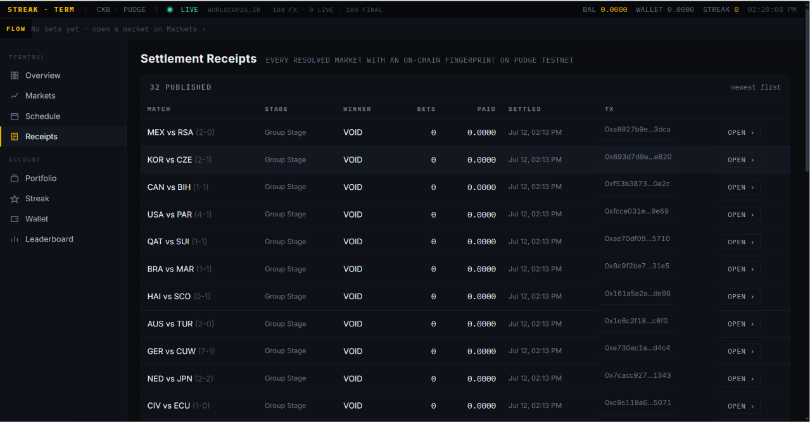
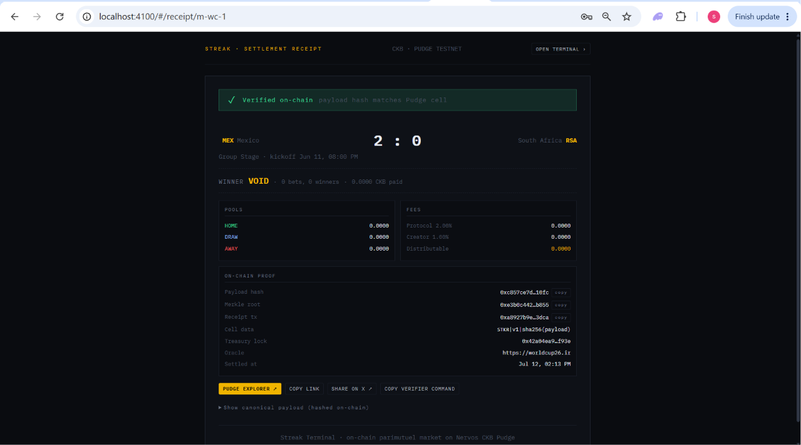

# Streak — Your game. Your call.

> _On-chain multi-league football prediction-market terminal,
> settled on the **Nervos CKB Pudge testnet**._

Streak is a football prediction application on **CKB Pudge testnet**, available at
[streakpitch.com](https://streakpitch.com). The React Season app at `/season/`
integrates wallet-signed direct predictions, combined-slip payments, settlement,
refunds and independently collectible returns. It also includes Matchday,
Streak Five fantasy football and Streak Survivor.

## Current architecture and custody

Updated 2 November 2026. Start with the [documentation map](docs/README.md),
[current status](status.md), [architecture](docs/architecture/overview.md) and
[agent contract](AGENTS.md).

- **Direct predictions:** funds are held in CKB cells governed by the versioned
  market and claim scripts. A slip can fund up to eight independent predictions
  in one transaction, including eligible market creation sponsored by Streak.
  Settlement creates funded claim cells; collection pays the entitled wallet.
  This is integrated application functionality, not separate future lab work.
- **Activity:** PostgreSQL holds an event-driven read model for fast history.
  It does not authorize payouts. Collection still validates live cells and the
  recipient against the on-chain rules.
- **Five and Survivor:** entries, scores and progression are application/database
  features. Sponsorships, creator-funded prizes, refunds and rewards use a separate
  **custodial testnet rewards wallet**, not the direct prediction scripts.
- **Competitions:** the new local implementation wraps existing prediction and
  Five flows with registration, configurable prizes, public standings and admin
  evidence exports. Campaign mainnet prizes are separate organizer-wallet transfers,
  verified against exact confirmed outputs. No mainnet signing key is held by the
  campaign API. See [configuration and release status](docs/delivery/competitions.md).
- **Legacy accounts:** the retained account application has a custodial treasury
  ledger for earlier deposits, virtual bets and withdrawals. Those liabilities
  are separate from Season direct positions.
- **Preview and local testing:** standalone design previews use synthetic data.
  The actual Season app is API-backed. Five/Survivor dummy data is an explicit
  local environment mode, not the default or a public mode switch.

Implementation references: [v4 scripts](contracts/direct-v4/README.md),
[combined-slip payments](docs/delivery/atomic-slip-correction.md),
[indexed Activity](docs/delivery/event-driven-activity.md),
[Five automation](docs/delivery/five-automatic-gameweeks.md) and
[Survivor creator prizes](docs/delivery/survivor-creator-prizes.md).
The historical [Week 20 lab](../../src/week20/contract-lab) remains independent.
[Early design notes](CONTRACT_DESIGN_NOTES.md) describe earlier research, not
the current implementation status.

The football result publisher remains trusted. Current v4 markets have four
deposit shards with eight position records each; integration does not establish
unlimited concurrency, mainnet readiness or completion of hosted acceptance.
Use the dated [status](status.md) and delivery records for evidence boundaries.

For changes, follow the [scoped quality gates](docs/delivery/quality.md): docs use
formatting/static policies, CSS adds a frontend build, and major runtime changes
require `npm run quality:major`. Install local hooks from the repository root
with `npm run hooks:install`. Hosted CI remains paused.

## Matchday

Open **Matchday** in the main navigation to follow scores, goals, cards,
substitutions, confirmed lineups and match statistics. Each match keeps your
picks beside the action and links to its receipt once settlement is published.

Matchday detail uses the existing API-Football configuration. It opens 90 minutes
before kickoff, checks competition coverage and shares cached provider requests.
Missing data is labelled; delayed updates retain their last successful timestamp.
These observations do not modify the frozen pre-match forecast or settle bets.

```bash
npm run test:matchday       # offline mappings, coverage, caches and failure states
npm run test:browser        # isolated browser flow and screenshots in data/qa
npm run check:matchday:live  # optional: read-only provider check; consumes API quota
```

Public API: `GET /api/markets/:id/matchday` returns section data, refresh state and
the published receipt reference. Personal picks remain in the existing
session-aware `GET /api/markets/:id` response. UI routes are `#/matchday` and
`#/matchday/:marketId`.

The on-chain design is modelled after two CKB references:

- **[calledAdo/asset-up-down-pools](https://github.com/calledAdo/asset-up-down-pools)** — parimutuel BTC up/down pools on CKB. Players stake into
  one of two sides, the pool resolves at `close_time` from an authenticated
  oracle, and winners redeem pro-rata against the losing side. Streak applies
  the same pool model to 3-way match outcomes (Home / Draw / Away).
- **[calledAdo/lean-oracle](https://github.com/calledAdo/lean-oracle)** — Pyth /
  Wormhole price oracle on CKB. Streak's `livescores.ts` plays the equivalent
  role for football results, with the existing `worldcup26.ir` REST feed acting
  as the oracle source.

---

## Quick start

```bash
cd products/streak
npm install
npm run build
npm start
```

Open the landing page at <http://localhost:4100> and the API-backed Season app at <http://localhost:4100/season/>. The legacy account application remains at `/index.html`; previously shared hash links still work. See the [direct integration setup](docs/delivery/direct-testnet-milestone.md) and later [wallet compatibility notes](docs/delivery/wallet-compatibility.md) for configuration and supported flows.

For a compiled server, run `npm run build` followed by `npm run serve`.
See [PERFORMANCE.md](PERFORMANCE.md) for the request architecture, measurements,
cache freshness, and withdrawal recovery behavior.

In Season, connect a supported wallet and sign the login challenge. Fund the
wallet with testnet CKB from the [Pudge faucet](https://faucet.nervos.org/), choose
fixture outcomes, then review the slip's stake, refundable storage and network
fee before signing. **You do not deposit into the legacy platform balance to
fund a direct prediction.** After settlement, collect available returns from
Activity using your wallet.

The API alone is not the complete payment system. Direct market configuration,
the separate sponsor and lifecycle operator, and the Activity relay must also
be configured. See the [direct integration setup](docs/delivery/direct-testnet-milestone.md)
and [combined-slip delivery](docs/delivery/atomic-slip-correction.md). Game rewards
have their own worker and funding configuration.

The following receipt command applies to the **legacy receipt system**, not
direct-position claim verification:

Verify a legacy settlement receipt:

```bash
npm run verify -- m-wc-6            # against local http://localhost:4100
STREAK_BASE=https://your.host npm run verify -- m-wc-6
```

---

## Notifications (Telegram)

Streak supports pluggable notification providers. To enable Telegram
notifications set environment variables in `products/streak/.env` or your
process environment:

```
NOTIFY_PROVIDER=telegram
TELEGRAM_BOT_TOKEN=<your-bot-token>
TELEGRAM_CHAT_ID=<numeric-chat-id-or-@username>
```

When configured the server will post short messages for streak picks, published
receipts and revive rebates. Use `NOTIFY_PROVIDER=telegram npm start` to run.

Users can connect Telegram from the Account page with one click (no manual chat
id copy/paste):

- App creates a short-lived deep link token.
- User opens Telegram and taps **Start** on the bot.
- Webhook links `chat.id` to the signed-in user automatically.

You can also set your personal Telegram chat id from the app (Settings) or via
API to receive direct messages. POST `/api/me/notify` with JSON `{ "telegramChatId": "@you_or_numeric_id" }`.

---

## Persistence: relational Postgres store

Streak's state used to live as a **single JSON blob** — one `jsonb` column in one
row (`streak_state.data`), which was itself just the old `data/db.json` moved
behind an HTTP API. That shape made the unit of both reading and writing the
_entire ledger_, so cost scaled with total history rather than with what a
request actually needed:

|                              | before (single row) | after (tables)               |
| ---------------------------- | ------------------- | ---------------------------- |
| a read (any endpoint)        | ~3.1 MB             | ~1.6 MB, cached; ~20 ms warm |
| a write (e.g. placing a bet) | ~3.1 MB upsert      | only the changed rows        |
| fetching one receipt         | ~3.1 MB             | ~1 KB by primary key         |

The blob was 3.1 MB and growing by one market plus one receipt per settled
fixture. Roughly half of it — 1.5 MB of settlement receipts — was archive data
that only two endpoints ever read, always by `marketId`, yet it rode along with
every single read. Meanwhile a 100-byte balance change rewrote all 3.1 MB.

### What the migration changed

State now lives in thirteen tables (see `scripts/sql/001_schema.sql`):
`users`, `matches`, `markets`, `bets`, `deposits`, `withdraws`, `receipts`,
`crews`, `telegram_links`, `renewal_txs`, plus `market_history` /
`market_insights` side tables and a small `streak_meta` singleton.

Four properties matter:

- **Diffed writes.** `update()` compares the mutated draft against the last
  committed snapshot and sends only changed rows, in one transaction. This is
  where nearly all the speed-up comes from — writes are no longer proportional
  to the size of the ledger.
- **Receipts are archive data.** `loadDB()` leaves `receipts` empty; they are
  read through `readReceipt(marketId)` / `readReceipts(limit)`. Writing is
  unchanged — push onto `db.receipts` inside `update()` and the diff upserts it.
- **Deletes are never inferred from absence.** Callers reassign whole
  collections (`pruneStaleSimMarkets` does), which under a diffed write would
  otherwise read as "delete everything missing". Removals must be named
  explicitly via `store.purge({ markets, matches })`, and `deleteMarkets`
  refuses to drop anything carrying bets or an on-chain receipt.
- **Constraints the blob could not enforce.** `renewal_txs.tx_hash` and
  `deposits.tx_hash` are now unique keys, so replay guards are enforced by the
  database instead of by scanning an array. Money is `numeric(40,0)`, which
  node-postgres returns as a string — exactly the shannon-string convention the
  code already uses, with no precision loss.

Reads are still a full materialisation of the working set minus receipts.
Narrowing them further needs a lifecycle window (recent kickoffs plus anything
unresolved) rather than a status filter, because excluding `status = 'final'`
matches would stop the settle loop from ever seeing a fixture that just ended.

### Configuration

```
DATABASE_URL=postgresql://<user>:<password>@<host>:5432/<database>   # replace placeholders
STORE_READ_TTL_MS=5000     # shared snapshot freshness; 0 disables TTL caching
PG_POOL_MAX=5              # optional (default: 5)
PG_CONNECT_TIMEOUT_MS=20000 # optional (default: 20000)
```

`DATABASE_URL` takes precedence over the Supabase and file backends. As with
Supabase, a failed read or write surfaces an error rather than silently falling
back to a different balance ledger.

### Migrating an existing blob

```bash
# dry run: integrity check, row counts, money reconciliation, round-trip diff
node scripts/migrate-to-tables.cjs --from data/db.json --to "$DATABASE_URL"

# commit (only proceeds if the round-trip comparison is identical)
node scripts/migrate-to-tables.cjs --from data/db.json --to "$DATABASE_URL" --apply
```

The migration is insert-only: it never modifies or deletes the source, so the
blob remains a rollback. It refuses to run against a source with orphaned rows,
duplicate ids or malformed amounts, then re-materialises the tables back into
`StreakDB` shape and deep-compares them against the source — committing only if
every record round-trips exactly and escrow reconciles to the shannon.

`scripts/dump-state.cjs` pulls the authoritative blob straight from Postgres,
bypassing PostgREST (useful when a project is API-gated but the database is
reachable), and falls back to the Supavisor pooler when the direct host is
IPv6-only.

Regression checks live in `src/store_pg.test.ts` (`npm run test:store:pg`) and
skip cleanly when no database is reachable.

## Legacy: Supabase-backed persistence (single JSON row)

Superseded by the relational store above; kept for reference and as a fallback
when `DATABASE_URL` is unset. Streak can use Supabase as the primary store
instead of the local `data/db.json`, persisting the whole state as one `jsonb`
row. To enable, create a table (suggested schema) and set the environment
variables below. When Supabase is configured the app upserts
the state into a single row and requests an empty write response. A failed
remote read or write surfaces an error; the app does not switch to a different
local balance ledger during an outage. Without Supabase it uses the JSON file.

Run one Streak server process per state file or Supabase row. The mutation queue
serializes writes within that process; it is not a distributed database lock.
Readers share immutable committed snapshots and concurrent cache misses share
one fetch. Writes use isolated drafts, acknowledge after durable persistence,
and skip storage when the serialized state has not changed. Invalid local JSON
raises an error and is left intact for recovery.

Required `.env` variables:

```
SUPABASE_URL=https://your-project.supabase.co
SUPABASE_KEY=eyJ...your-service-role-or-anon-key
SUPABASE_DB_URL=postgres://postgres:<password>@db.<project-ref>.supabase.co:5432/postgres
SUPABASE_TABLE=streak_state   # optional (default: streak_state)
SUPABASE_ROW_ID=singleton     # optional (default: singleton)
STORE_READ_TTL_MS=1500       # shared snapshot freshness; 0 disables TTL caching
STORE_REQUEST_TIMEOUT_MS=8000 # Supabase HTTP deadline in milliseconds
```

For isolated development and tests, set `STREAK_DATA_DIR` to a separate data
directory, or set `STREAK_DB_FILE` to the exact JSON file to use. The explicit
file setting takes precedence. Neither setting disables Supabase: unset
`SUPABASE_URL` and `SUPABASE_KEY` when a local test must use the file backend.

Table layout (example SQL):

```sql
create table streak_state (
  id text primary key,
  data jsonb
);
```

If `SUPABASE_DB_URL` is set, Streak now auto-creates this table on startup
(`create table if not exists ...`).

With Supabase enabled the following env vars are relevant for notifications
and providers as well: `NOTIFY_PROVIDER`, `TELEGRAM_BOT_TOKEN`, `TELEGRAM_CHAT_ID`, `MATCH_PROVIDER`.

For one-tap Telegram connect flow add:

```
TELEGRAM_BOT_USERNAME=your_bot_username_without_@
TELEGRAM_WEBHOOK_SECRET=long-random-secret
APP_PUBLIC_URL=https://your-public-app-url
```

`APP_PUBLIC_URL` must be reachable by Telegram (public HTTPS). On boot, Streak
will attempt to call Telegram `setWebhook` automatically.

## Legacy ledger market engine (parimutuel)

This section describes the retained ledger implementation. Season direct
predictions use the versioned scripts and funded claims linked above; they do
not credit a virtual escrow balance at resolution.

```
implied_prob[o]  = pools[o] / total_pool
decimal_odds[o]  = total_pool / pools[o]
```

When a match finalises, the winning outcome takes the whole losing pool minus
fees:

```
loserPool      = sum(pools[o] for o != winner)
protocolFee    = loserPool * 2.00%          → treasury
creatorFee     = loserPool * 1.00%          → market creator
distributable  = loserPool - protocolFee - creatorFee

payout(winning bet)  = stake + distributable * stake / winnerPool
payout(losing bet)   = 0
```

A market **voids** (and refunds every bet) if no one took the winning side.

### Market lifecycle

| Status     | Trigger                                                       |
| ---------- | ------------------------------------------------------------- |
| `open`     | Created (on first bet, or auto-seeded as `creator="system"`)  |
| `closed`   | Kickoff reached — bets rejected, awaiting result              |
| `resolved` | Match `final` from oracle → payouts credited to winner escrow |
| `void`     | No bet on the winning side, or no result available            |

The first user to bet on an auto-seeded market becomes its **creator** and
earns the 1% creator fee at resolution. If no human creator exists, the fee
accrues to the protocol pot instead.

### Custody (deposit / withdraw on-chain, bets virtual)

Bets are virtual ledger ops against a per-user **escrow balance**, but every
CKB on the platform corresponds to a real on-chain Pudge transaction:

- **Deposit** = real Pudge tx `wallet → treasury`, **signed by the user** in
  their own wallet; the server verifies the tx before crediting escrow.
- **Bet / claim** = fast virtual ops against escrow.
- **Withdraw** = real Pudge tx `treasury → wallet`, signed by the treasury,
  paid to the user's connected address.
- **Streak revive** = real Pudge tx `wallet → treasury` (63 CKB), user-signed.

Betting stays snappy (virtual escrow) without paying a cell-floor on every
micro stake, while every deposit and renewal is a real, user-signed transfer
the server confirms on-chain. Minimum on-chain transfer is **100 CKB** (cell
floor + fee headroom); minimum single bet against escrow is **10 CKB**.

---

## Legacy daily streak game

A **streak pick** is just a regular bet with `isStreakPick: true`. You can lock
exactly one tagged bet per UTC day.

| Outcome | Effect on streak                                    |
| ------- | --------------------------------------------------- |
| ✅ Won  | `streak += 1` (best high-water mark updates)        |
| ❌ Lost | streak enters **failed** state, frozen at its value |
| ⚪ Void | streak unchanged, today's pick slot is freed        |

A failed streak must be resolved before the next pick:

- **Revive** → pay **63 CKB** from your wallet to the treasury (real Pudge tx)
  and keep your streak value.
- **Reset** → wipe to zero. No payment. Best streak is preserved.

---

## Application architecture

| Area                 | Implementation and responsibility                                                                                                         |
| -------------------- | ----------------------------------------------------------------------------------------------------------------------------------------- |
| Season frontend      | React, TypeScript and Vite in `web/src`; built into `public/season`. Wallet connection, signing, payment recovery and claims.             |
| API                  | `src/server.ts` and feature modules; authentication, fixture catalogue, game operations and saved Activity reads.                         |
| Direct payments      | `src/modules/direct` and `web/src/features/direct`; transaction building, sponsor coordination, signed recovery and lifecycle operations. |
| On-chain enforcement | Versioned Rust scripts in `contracts/direct-v4`; market transitions, funds, refunds and claims. Earlier versions retain their own rules.  |
| Activity index       | `src/modules/activity`; durable event delivery and PostgreSQL projections. Live-chain validation remains spending authority.              |
| Games                | `src/modules/five` and `src/modules/survivor`; PostgreSQL entries and progression, with separate custodial rewards delivery.              |
| Legacy application   | Vanilla `public/app.js`, ledger/treasury and receipt modules; retained separately from direct positions.                                  |

The Season frontend requires a build. `ts-node` can run the API source, but does
not compile frontend assets. Local JSON storage supports legacy development;
it is not a substitute for PostgreSQL-backed game and Activity features. See
[architecture and migration](docs/architecture/overview.md) for module boundaries.

## Season interface

Season uses a dark responsive layout with a shared prediction slip, wallet
controls, payment recovery, linked-cell loading animations and dedicated game
workspaces. The following design description belongs to the older account UI.

---

## Legacy UI / design language

Warm parchment, oxblood ink, forest green and muted blue. Serif headings and
tabular figures sit alongside numbered pages, fine ruled dividers, a daily
journal and a CSS-rendered book cover. System fonts render immediately.

Layout:

- **Book spine** — numbered navigation, account link and sign-out.
- **Edition header** — date, feed status, testnet label and available balance.
- **Activity strip** — recent entries without a continuously animated marquee.
- **Overview** — four ledger totals, featured fixture, daily streak journal,
  recent entries and standings.
- **Responsive pages** — compact market odds and an early bet form on phones,
  keyboard controls, focus-managed dialogs and reduced-motion support.

Pages: `Overview`, `Markets` (filterable table with price-cells and sparklines),
`Market detail` (large implied-prob chart, order-book-style bet feed, place-bet
panel, pool composition, **on-chain settlement panel with share links**),
`Schedule`, `Streak`, `Portfolio`, `Account` (`#/wallet`), `Leaderboard`, `Receipts`
(chronological wall of every published settlement receipt), and a public,
unauthenticated `#/receipt/:marketId` page for sharing individual results.

---

## Legacy on-chain settlement receipts

These receipt cells attest to legacy ledger settlement. Direct predictions use
script-enforced market transitions and funded claim cells instead.

Every resolved market publishes a **receipt cell** on Pudge so anyone — with no
account, no server access, no trust in this codebase — can verify a settlement
independently.

### Design

To keep testnet costs low the on-chain cell only holds a compact fingerprint;
the full receipt payload lives off-chain and is served by the API.

```
┌─── Off-chain (this DB / API) ───────────────────────────────────────┐
│ SettlementReceipt payload (canonical UTF-8 JSON)                    │
│ → served at /api/receipts/:marketId                                 │
└────────────────────┬────────────────────────────────────────────────┘
                     │ sha256(canonical bytes)
                     ▼
┌─── On-chain (Pudge cell) ───────────────────────────────────────────┐
│ Lock:  treasury (only the treasury key can publish)                 │
│ Type:  none                                                         │
│ Data:  magic "STKR" (4) | version (1) | sha256 (32) = 37 bytes      │
│ Cap :  100 CKB  (min ~98; = 8 + 53 lock + 37 data)                  │
└─────────────────────────────────────────────────────────────────────┘
```

A **merkle root over every bet** is embedded in the payload so a bettor can
produce an inclusion proof for their own bet. Leaves are ordered by `placedAt`
and hashed as `sha256({betId, userHash, outcome, amountShannons})`, where
`userHash = sha256(userId + ":" + marketId)` — identity doesn't leak across
markets while a user can still prove ownership of their own leaves inside a
single market.

### Verifying, three ways

1. **In the app** — the Market Detail page shows a green "✓ VERIFIED ON-CHAIN"
   chip when the on-chain cell exists and its hash matches. Click **Public
   receipt ›** for a shareable page (`#/receipt/:marketId`) that works without
   signing in.
2. **Via API** — `GET /api/receipts/:marketId` performs a fresh Pudge RPC
   round-trip and returns `{onChain: {ok, onChainPayloadHash, ...}}`.
3. **Standalone CLI** — `npm run verify -- <marketId>` doesn't touch the
   server internals at all. It fetches the payload from the HTTP API,
   canonicalises + sha256s it, rebuilds the merkle root over the bet set, and
   queries public CKB RPC directly to compare the on-chain hash + treasury
   lock:

   ```
   $ npm run verify -- m-wc-6
   Streak receipt verifier
     market         m-wc-6
     api base       http://localhost:4100
   1. payload
     ✓ sha256(payload) matches server: 0xcd5fb6a3c82637c7…
   2. merkle root
     ✓ merkle root over live bet set matches payload
   3. on-chain cell
     magic          STKR
     version        1
     ✓ on-chain hash matches computed payload hash
   ✓ verified — this receipt is authentically pinned on Pudge
   ```

   Point the CLI at a remote instance with `STREAK_BASE=https://…` or
   `--base https://…`.

Every published receipt shows up in the **Receipts** gallery in the left rail
(and at `#/receipts`):



And each one has an unauthenticated shareable page at
`#/receipt/:marketId` — designed to be pasted into a group chat:



### Treasury funding

Each receipt cell locks up ~100 CKB of capacity. In practice this means the
treasury wallet has to be pre-funded — set `TREASURY_PRIVATE_KEY` in `.env` to
reuse a wallet you've already funded from the [Pudge faucet][faucet], or leave
it blank and fund the address printed at boot. If the treasury runs low, the
engine keeps the receipt in a `PENDING` state and retries silently until it can
pay, logging a nudge once per hour.

[faucet]: https://faucet.nervos.org/

---

## Live WC2026 data (worldcup26.ir)

Real fixtures (teams, matches, stadiums) ship vendored in `src/data/` from the
open-source [rezarahiminia/worldcup2026](https://github.com/rezarahiminia/worldcup2026)
dataset (ISC). To enable **live in-play scores and final results** (the oracle
that resolves markets), set either:

| Env                                | Notes                                                                   |
| ---------------------------------- | ----------------------------------------------------------------------- |
| `WC_API_TOKEN`                     | Paste an existing JWT. Skips bootstrap.                                 |
| `WC_API_EMAIL` + `WC_API_PASSWORD` | Server auto-registers, logs in, caches the JWT in `data/db.json`.       |
| `WC_API_NAME`                      | Display name used during auto-registration (default `Streak Terminal`). |
| `WC_API_BASE`                      | Override the API base URL (default `https://worldcup26.ir`).            |

With nothing configured the game falls back to a deterministic simulated result
keyed by match id (`src/matches.ts`), so markets still settle consistently.

Inspect the live-scores wiring at runtime:

```bash
curl http://localhost:4100/api/status
```

---

## Match-data providers (pluggable feed)

Fixtures + results come through a single seam, `MatchDataProvider`
([src/providers/types.ts](src/providers/types.ts)). Pick one with
`MATCH_PROVIDER`; nothing in the engine changes when you swap feeds.

| `MATCH_PROVIDER`                                  | Feed                                                                                                                              |
| ------------------------------------------------- | --------------------------------------------------------------------------------------------------------------------------------- |
| `football` (default when `API_SPORTS_KEY` is set) | Real API-SPORTS fixtures and confirmed results across configurable leagues.                                                       |
| `worldcup`                                        | Real WC2026 fixtures + the worldcup26.ir oracle above.                                                                            |
| `dummy`                                           | A self-contained simulator: 20 Premier League clubs, round-robin gameweeks, matches that kick off / run / finish on a real clock. |

The real football provider loads a rolling fixture window for the Premier
League, La Liga, Bundesliga, Serie A, Ligue 1 and Champions League by default.
It batches concurrent live fixtures, caches schedules, exposes remaining quota
in `/api/status`, and requires two identical terminal responses before a market
can settle. If the API is unavailable, real markets stay pending; the engine
never substitutes a simulated winner. If one competition request fails while
the others succeed, its successful caches remain available and the missing
competition is retried after one minute rather than waiting for the six-hour
schedule refresh.

### Active-feed provenance and legacy data

API-Football fixtures are identifiable end to end: their internal ids begin
with `api-football-`, their `oracle.provider` is `api-football`, and their team
objects carry the provider's image-logo URLs. The active Schedule, Markets,
dashboard headline, activity ticker and market totals accept only rows owned by
the selected provider. Consequently, old simulator rows such as `epl-2-2` and
their emoji placeholders can remain in a migrated database for historical
bets/receipts without appearing as current paid-feed fixtures.

Changing `MATCH_PROVIDER` requires a server restart. After restarting, confirm
the boundary with `GET /api/status`: `provider` should be `football`, `enabled`
should be `true`, and `simulated` should be `false`. A real fixture returned by
`GET /api/matches` should also include `oracle.provider: "api-football"` and
HTTP logo URLs for both teams.

### Market vs Machine analytics

Week 15 adds an auditable comparison between three probability sources on each
market detail page:

- **Crowd** — the live Streak pool split;
- **Machine** — API-Football's home/draw/away prediction;
- **Books** — the vig-free mean probability across available `Match Winner`
  bookmakers.

The same response includes table rank, points, form and the last five
head-to-head meetings. It is intentionally partial-data tolerant: coverage is
checked through `/leagues` first, and a missing prediction, odds row or table
becomes a visible warning rather than a made-up value.

Quota is protected by endpoint-specific caches: coverage 24 hours, standings
and predictions one hour, bookmaker odds three hours, and head-to-head history
12 hours. Concurrent requests share the same in-flight promise. During the
final 90 minutes before kickoff, the background loop warms at most four stale
fixtures per pass; those limits are configurable with
`FOOTBALL_INSIGHT_PREFETCH_MINUTES` and `FOOTBALL_INSIGHT_PREFETCH_BATCH`.

At kickoff the engine combines the latest provider data with the exact crowd
pool, freezes it on the market, and computes a canonical SHA-256 snapshot hash.
Settlement receipt schema v3 embeds the full frozen comparison, so later model
or bookmaker updates cannot rewrite what participants saw before betting
closed.

```bash
MATCH_PROVIDER=dummy npm run streak    # simulated EPL fixtures, live now
MATCH_PROVIDER=football npm run streak # API-SPORTS multi-league feed
```

The simulator maps stable `epl-s<slot>` ids onto absolute wall-clock slots, so
its rolling window survives restarts without a persisted anchor. Tunables:
`DUMMY_STAGGER_MIN` (20), `DUMMY_MATCH_MINUTES` (96), `DUMMY_PAST_SLOTS` (6)
and `DUMMY_AHEAD_SLOTS` (48).

---

## Legacy and shared API reference

This list predates the integrated direct-payment, Activity, Five and Survivor
APIs. It is not the complete Season API. In particular, ledger bet/deposit/withdraw
routes below do not describe the direct slip payment flow.

```
POST /api/auth/nonce             → { address }     login challenge to sign
POST /api/auth/verify            → { address, signature, challengeId }  verify + start session
POST /api/logout
GET  /api/me                     → current user (public view)
POST /api/me/username            → { username }    set/change display name
GET  /api/dashboard              → one-shot terminal payload (user, headline,
                                   counts, leaderboard top, tape)
GET  /api/markets[?status=open&competition=39] → filterable market list
GET  /api/markets/:id            → market detail (chart, feed, my positions)
GET  /api/markets/:id/insights   → crowd/model/books comparison + context
POST /api/markets/:id/bet        → { outcome, amountCkb, asStreakPick? }
GET  /api/portfolio              → all my positions + open stake + realised P&L
GET  /api/wallet                 → on-chain + escrow balances, recent ledger
POST /api/wallet/deposit         → { txHash }      credit escrow from a user-signed tx
POST /api/wallet/withdraw        → { amountCkb }   real Pudge tx treasury→wallet
POST /api/renew                  → { txHash }      revive from a user-signed 63 CKB tx
POST /api/reset                  → abandon a failed streak (zero, free)
GET  /api/crews                  → my crews (H2H streaks, co-picks, feed)
POST /api/crews                  → { name }        create a crew
POST /api/crews/join             → { code }        join by invite code
POST /api/crews/:id/leave        → leave (ownership hands over / crew deleted)
GET  /api/leaderboard            → top 100 by realised P&L
GET  /api/matches[?competition=39] → filterable fixture schedule
GET  /api/status                 → live-oracle status + economic constants
GET  /api/receipts               → every published settlement receipt (public)
GET  /api/receipts/:id           → full payload + fresh on-chain verification
GET  /api/receipts/:id/proof     → merkle inclusion proof(s) for ?bet= or ?mine=1
```

---

## Security and custody boundaries

Wallet connection and sign-in establish identity; they do not determine who
holds funds. Users retain their wallet keys and approve wallet signatures.

- Direct prediction funds and funded claims are governed by CKB lock/type
  scripts. The configured oracle/result publisher remains trusted for football
  outcomes. Sponsor and lifecycle services coordinate transactions; a database
  balance or index entry cannot override script-enforced payout rules.
- Five/Survivor reward funding is custodial. The dedicated rewards wallet holds
  contributions and signs prize/refund payouts under the application's rules.
- Legacy deposits transfer funds to the treasury before a database balance is
  credited. Legacy withdrawals require a treasury-signed transaction. A user
  signing that initial deposit does not make the subsequent ledger non-custodial.

Server-side signing roles therefore extend beyond the legacy
`TREASURY_PRIVATE_KEY`. Direct sponsor/operator and game rewards credentials
have separate configuration and responsibilities. Never put signing keys in
frontend assets or use production credentials in synthetic tests.

See [direct integration boundaries](docs/delivery/direct-testnet-milestone.md),
[sponsorship auctions](docs/delivery/five-sponsor-auction.md) and
[Survivor funding](docs/delivery/survivor-creator-prizes.md). Current operation is
on testnet; these integrations are not a mainnet audit or readiness claim.

## Configuration

The following **legacy ledger** constants live in [src/config.ts](src/config.ts).
They do not define all direct-script or game economics. Direct parameters are
versioned with the scripts and registry; game terms are stored per competition.

| Constant                 | Default | Purpose                                                              |
| ------------------------ | ------- | -------------------------------------------------------------------- |
| `MIN_BET_CKB`            | 10      | Smallest single bet against escrow                                   |
| `MAX_BET_CKB`            | 100000  | Sanity cap on a single bet                                           |
| `MIN_ONCHAIN_CKB`        | 100     | Cell-floor minimum for on-chain deposit/withdraw                     |
| `PROTOCOL_FEE_BPS`       | 200     | 2.00% of loser pool → protocol treasury                              |
| `CREATOR_FEE_BPS`        | 100     | 1.00% of loser pool → market creator                                 |
| `RENEW_FEE_CKB`          | 63      | Streak revival fee (real on-chain)                                   |
| `CREW_REVIVE_REBATE_CKB` | 20      | Escrow rebate per crew-mate who co-picked the revived match (cap 40) |
| `SETTLE_INTERVAL_MS`     | 20000   | Background slate-refresh / settlement cadence                        |
| `MARKET_HISTORY_CAP`     | 480     | Max implied-prob ticks retained per market                           |

Legacy/shared environment reference (not a complete deployment configuration).
Enabled features require their documented provider, database and signing settings:

| Var                                                                                    | Default                                                 | Purpose                                                                                       |
| -------------------------------------------------------------------------------------- | ------------------------------------------------------- | --------------------------------------------------------------------------------------------- |
| `PORT`                                                                                 | `4100`                                                  | HTTP port                                                                                     |
| `MATCH_PROVIDER`                                                                       | `football` when an API key exists, otherwise `worldcup` | Active fixture/result feed (`football`, `worldcup` or `dummy`).                               |
| `API_SPORTS_KEY`                                                                       | —                                                       | Server-only API-SPORTS credential. A paid football plan is required for the current season.   |
| `FOOTBALL_LEAGUE_IDS`                                                                  | `39,140,78,135,61,2`                                    | API-Football competition ids to load.                                                         |
| `FOOTBALL_SEASON`                                                                      | inferred                                                | Season starting year (`2026` means 2026/27).                                                  |
| `FOOTBALL_FIXTURE_PAST_DAYS` / `FOOTBALL_FIXTURE_FUTURE_DAYS`                          | `2` / `21`                                              | Rolling schedule/recovery window.                                                             |
| `FOOTBALL_LIVE_POLL_SECONDS`                                                           | `20`                                                    | Live and final-confirmation polling cadence (minimum 15 seconds).                             |
| `FOOTBALL_FINAL_CONFIRMATIONS`                                                         | `2`                                                     | Matching terminal snapshots required before settlement.                                       |
| `FOOTBALL_SCHEDULE_REFRESH_MINUTES`                                                    | `360`                                                   | Long-lived schedule cache TTL.                                                                |
| `FOOTBALL_INSIGHT_PREFETCH_MINUTES`                                                    | `90`                                                    | Begin warming analytics this many minutes before kickoff.                                     |
| `FOOTBALL_INSIGHT_PREFETCH_BATCH`                                                      | `4`                                                     | Maximum stale fixtures warmed during one settlement pass.                                     |
| `DUMMY_STAGGER_MIN` / `DUMMY_MATCH_MINUTES` / `DUMMY_PAST_SLOTS` / `DUMMY_AHEAD_SLOTS` | `20` / `96` / `6` / `48`                                | Shape the rolling simulated schedule (dummy provider).                                        |
| `WC_API_TOKEN` / `WC_API_EMAIL` + `WC_API_PASSWORD`                                    | —                                                       | Enable live oracle.                                                                           |
| `WC_API_BASE`                                                                          | `https://worldcup26.ir`                                 | Override oracle base URL.                                                                     |
| `WC_API_NAME`                                                                          | `Streak Terminal`                                       | Display name during auto-registration.                                                        |
| `TREASURY_PRIVATE_KEY`                                                                 | _auto-generated_                                        | Reuse a funded Pudge wallet as the treasury (needed to publish on-chain settlement receipts). |
