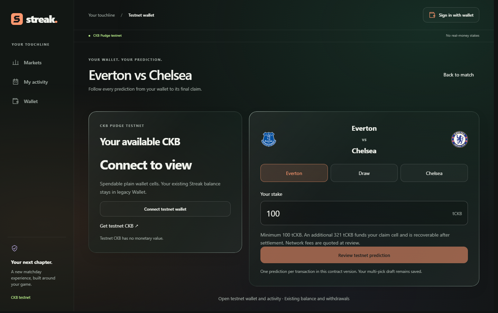
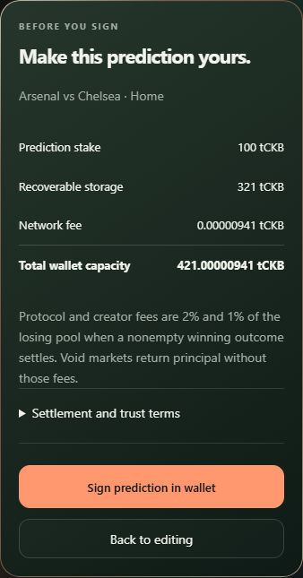
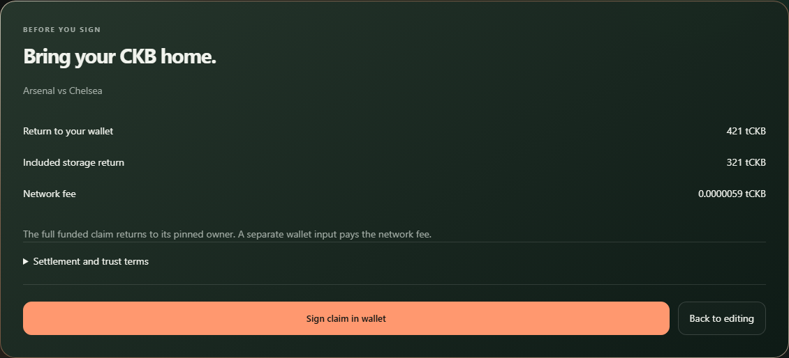

# Direct testnet prediction journey

Date: **16 October 2026**, Africa/Lagos. Branch: `feat/streak-direct-testnet`, based on UI correction `ef2d4db7ce03adc1812438de58439acf09abce7d`. This increment implements the five authorized steps in the Season app using the unchanged deployed Week 20 Rust contracts.

## Delivered behavior

| Step    | User experience and authority                                                                                                                                                                 |
| ------- | --------------------------------------------------------------------------------------------------------------------------------------------------------------------------------------------- |
| Connect | Choose a CKB testnet wallet, verify its lock and show available untyped CKB. A signed-in account must match the connected wallet.                                                             |
| Review  | Open a funded API fixture and choose Home, Draw or Away. Review principal, 321 CKB recoverable storage, exact network fee, fixture terms and result trust.                                    |
| Sign    | Recheck immutable terms and live inputs, request the wallet signature, validate the signed transaction, and save its bytes and hash before broadcast.                                         |
| Confirm | Show transaction links and canonical confirmations. Reload restores the signed record. An unknown response permits only the original transaction retry.                                       |
| Claim   | Discover wallet-owned positions and eligible results. Review and sign a separate winning claim, losing-storage return or cancellation refund. Export a recovery file for the independent CLI. |

The approved Season appearance and existing Minimize-only Genie slip remain. The slip can hand one prediction to the direct review. Multiple picks remain saved together, but combined payment requires a future contract version. This increment never splits one approved basket into several payments.

## Contract and oracle boundaries

The contract bounds remain four shards with eight positions each, a 100 CKB minimum principal and one deposit or claim per transaction. Claims use a separate fee input so the full funded entitlement reaches the owner. Void markets return principal and storage without betting fees. A losing position returns storage. The existing 2% protocol and 1% creator fees apply to the losing pool when a funded winning outcome exists.

The football catalogue is immutable and API-backed. It pins fixture identity, kickoff, regulation-time rules, creation transaction and script. Its metadata digest is not inside the current contract args. Users trust the catalogue mapping and configured result reporter. Each market pins its own admin; the existing deployment is not a globally restricted Streak factory. This limitation is disclosed in the UI and [chain architecture](../architecture/chain.md).

The operator is separate from the API and browser. It requires explicit signing configuration and durable storage. Result reporting requires two matching raw full-time score observations at least 30 seconds apart. Missing scores never become an invented draw. Later transitions check the report's actual creation header against the six-hour window. A timely report remains eligible after the deadline; an ineligible late report does not prevent timeout cancellation.

The worker handles at most four markets per pass, with bounded requests and a durable cursor. It reconciles saved operations before building more. Contention and uncertain outcomes stop for review. Sequential shard selection is local to each connected client; there is no global transaction scheduler. See the [operations and recovery runbook](../operations/direct-testnet.md).

## Recovery and review findings

Independent review covered funds, signatures, immutable fixture mapping, canonical headers, browser identity, operator jobs and recovery. Fixes include uncached shard and receipt reads, exact header-to-cell binding, strict raw score validation, safe journal ownership, durable input reservations and account-change isolation.

A confirmed conflicting transaction can prove a saved transaction is impossible on the current chain. The user explicitly supplies its hash; the client verifies a shared input and three canonical confirmations before allowing a new review. The original bytes remain saved. If that proof is reorganised out, the reservation becomes active again. The independent recovery CLI applies the same rule.

The app initially shows eight transactions and checks four markets. Full position scans are manual; unresolved transaction polling pauses while hidden. The current pilot limits are 128 local transaction records and 256 registered markets. A broader pilot needs a reviewed archive/indexer strategy, supported-wallet matrix, operational monitoring and durable-volume restore evidence.

## Verification

Focused domain, HTTP, wallet and standalone recovery checks pass. The built browser journey runs in Chromium and WebKit at 390 and 1440px with actual IndexedDB and synthetic chain responses. It covers signature rejection, exact review, persistence before submission, refresh retry, claim conflicts and storage failure. Synthetic browser data does not establish live settlement.

The signed local CKB lifecycle passes **25 checks** with actual product adapters and unchanged Rust binaries. It includes full six-hour cancellation, winning and losing claims, actual conflicting fee spends, proof reorgs, claim reorgs and exact-byte resubmission after reload. Evidence: `.quality-artifacts/direct-chain/devnet.json`.

The full **35-step** `npm.cmd run quality:major` gate passed at **11:48 UTC on 16 October**. It includes disposable PostgreSQL, 22 Season browser groups, four direct wallet journeys, 18 general preview groups, 32 combined-slip preview groups, unchanged Rust VM/accounting checks and the 25 signed local-chain checks. Local evidence: `.quality-artifacts/direct-full-gate.json` and `.quality-artifacts/direct-full-gate.log`.

Browser regression fixes isolate deliberately failed module loading from API recovery, capture short Genie frames in the same browser task that observes them, and wait for the actual viewport resize event before testing a separate interruption. Recovery, paint and cleanup assertions remain. A bounded request trace is retained for diagnosing future slip-review transport failures. No production workaround or test retry was added to conceal them.

Public testnet verification passed separately at **11:13 UTC**, with all seven transactions confirmed. Local commit and push hooks repeat the complete gate for the candidate being published. Hosted GitHub Actions remain paused under the owner's billing override. No hosted deployment, production capacity or security audit is claimed.

## Public testnet evidence

This separately authorized run uses the already deployed scripts and actual product adapters. Its fixture and score are synthetic and are never added to the real football catalogue. One development wallet supplies both outcome positions and operator funding. Independent-owner and full six-hour refund coverage comes from the local devnet. This is protocol verification, not user engagement or a real match result.

| Confirmed action           | Explorer transaction                                                                                                                |
| -------------------------- | ----------------------------------------------------------------------------------------------------------------------------------- |
| Market creation            | [0x907d6b9ae3...](https://pudge.explorer.nervos.org/transaction/0x907d6b9ae3dd89c59165e0bbd955539c9bd71306f6a954ee8e1724a73697d06e) |
| Winning prediction deposit | [0xd0a3220980...](https://pudge.explorer.nervos.org/transaction/0xd0a3220980c94a1dd8211779f70fb502a1885af567d71ff669e3dec7168348a2) |
| Losing prediction deposit  | [0x4c10c8661d...](https://pudge.explorer.nervos.org/transaction/0x4c10c8661d8a8d34591c08e032affd5d574015690832d90589586aad8a24c863) |
| Synthetic result report    | [0xc89f628fdb...](https://pudge.explorer.nervos.org/transaction/0xc89f628fdb218f2769205c58736470e8ddf626e029573c95da91e1559fb4818b) |
| Settlement                 | [0x2fc658f101...](https://pudge.explorer.nervos.org/transaction/0x2fc658f101e758a9c81ea5f309bafdf502db82705d01d5ae3d21500ab59e4195) |
| Winning claim              | [0xf20bca227a...](https://pudge.explorer.nervos.org/transaction/0xf20bca227a055e2b01129c1f93495cb1387e34f3b732ce2ec6260be132df50d3) |
| Losing storage return      | [0x006e7d2851...](https://pudge.explorer.nervos.org/transaction/0x006e7d28519528a737fd08833b17cf8921bc984ddfb9d1683d6db84860cdc77f) |

The winning claim returns 615 tCKB: 294 tCKB entitlement plus 321 tCKB storage. The losing position returns 321 tCKB storage. Both use separate fee capacity. The run records base revision and loaded file hashes in its private local evidence directory; no wallet key is included.

## Local real-fixture activation

The local preview has one funded API-Football market: **Everton vs Chelsea**, fixture `1557430`, scheduled for **17 October 2026 at 11:30 UTC**. Its [creation transaction](https://pudge.explorer.nervos.org/transaction/0x3f32a15c506e68402c14f830fc25dfcb4862f9bd21ca609f261766856761bae7) was reconciled with six canonical confirmations before publication to the local registry. The public endpoint reports `entryEnabled: true`. A bounded operator pass correctly reports that the fixture is waiting for kickoff.

Open `http://127.0.0.1:4100/season/?direct=m-api-football-1557430` to try it with a supported testnet wallet. The local preview uses real API fixture names and logos. Manual Chromium checks at 390 and 1440px found no page errors and confirmed that signing requires wallet connection. The preview permits public reads and read-only slip review; old custodial account writes remain disabled. Direct transactions go from the connected wallet to CKB.

The operator worker has been exercised once locally. A persistent scheduled worker has not been deployed. The [runbook](../operations/direct-testnet.md) includes independent permissionless settlement or timeout using the exported descriptor if the operator is unavailable. Physical-wallet testing and hosted activation remain separate.

## UI evidence

The desktop capture below uses the actual funded API fixture and API team logos. It is disconnected from a user wallet and cannot sign until one is connected.

The mobile payment review and desktop claim below use clearly synthetic browser fixtures. They demonstrate layout and exact review, not additional public transactions. Their amounts are separate from the public-chain exercise above.

## Next boundary

Review and activate the documented durable operator setup before community onboarding. Keep existing custodial balances and withdrawals available at `/index.html`. Next protocol work is a reviewed fixture/rules commitment and combined independent payment, followed by Five integration and measured campaign engagement. Physical-device wallet compatibility and motion profiling remain outstanding.
