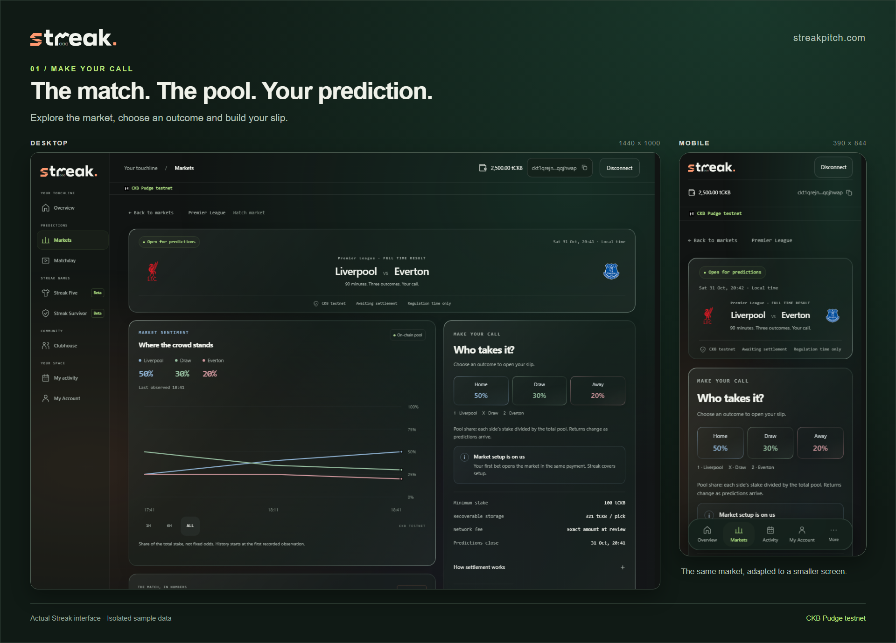
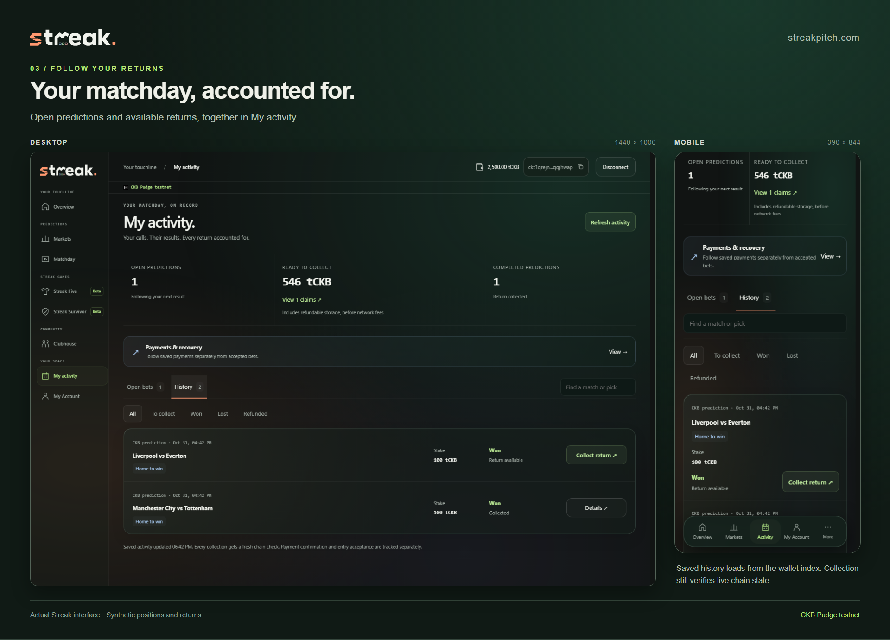
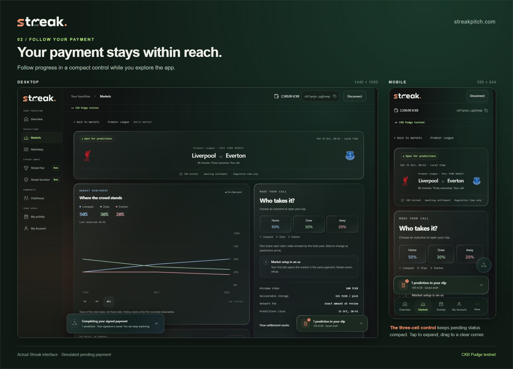
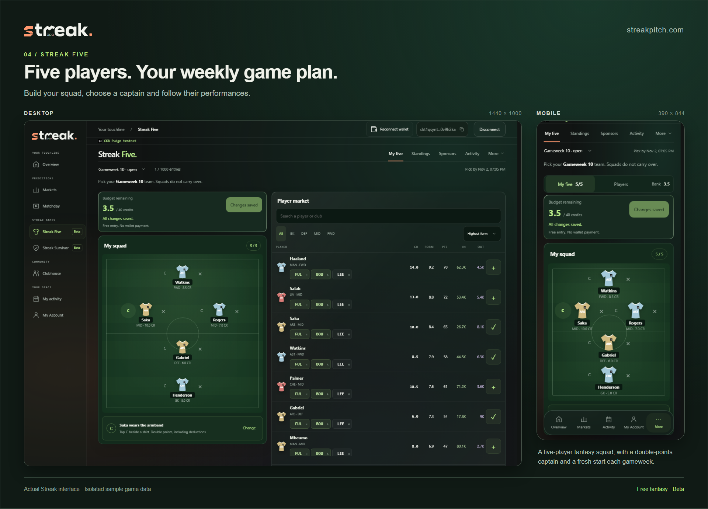
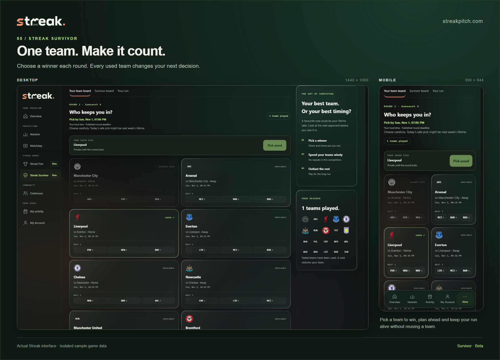

# Streak update: faster wallet history, recoverable payments and a growing football app

Streak now has its own home: **[streakpitch.com](https://streakpitch.com)**. Recent work has focused on the complete prediction journey: entering a market, following a payment, finding a return and collecting it reliably.

_Actual app components with synthetic local fixtures, shown on desktop and mobile. These screenshots are interface demonstrations, not evidence of live payments._

## One payment, independent positions

The latest prediction protocol supports **up to eight independent picks in one wallet payment**, including a mixture of new and existing markets. Each position later settles separately.

I changed provisioning so that the first prediction creates an eligible market, with Streak supplying its reserve capacity. That avoids locking capacity into every scheduled fixture before anyone participates.

The user supplies the stake, **321 tCKB of refundable position storage per pick**, and the reviewed network fee. Shared Rust scripts validate separate market, deposit-shard and claim cells. Earlier contract versions retain their original recovery paths; refactoring the app must not strand existing positions.

[Contract architecture, deployment and verification](https://github.com/HeySomtee/ckbuilder/blob/main/products/streak/docs/delivery/atomic-slip-correction.md)

## A slow Activity page changed the architecture

Originally, Activity searched market by market to find a wallet's positions. A central on-chain registry seemed like a shortcut, but requiring every update to consume and replace one shared cell would introduce contention between unrelated users.

I kept independent on-chain state and added an **event-driven wallet index**. Payment and lifecycle observations update PostgreSQL records; a changed market is reconstructed once for all its participants. Activity retrieves the wallet's history in one request, with prefetch starting after sign-in.

Durable event replay and targeted reconciliation cover missed updates and reorganisations. The index helps discover a claim; it cannot authorize spending. Collection still validates the live cells, recipient, amount and fee inputs.

A synthetic 24-market read measured roughly **18–34 ms locally with zero chain reads**. That is an isolated measurement, not a hosted latency promise.

_Synthetic local history demonstrating the same Activity interface at both sizes._

[Index design and evidence](https://github.com/HeySomtee/ckbuilder/blob/main/products/streak/docs/delivery/event-driven-activity.md)

## Refunds, payouts and interrupted payments

The configured football oracle remains trusted for results. Contracts enforce settlement accounting and create independently spendable claims: winners receive their calculated returns and recoverable storage; losing positions recover their storage. Collection has a separately reviewed network fee. Void, timeout and late-entry cases retain their respective refund paths.

Signed transaction bytes are saved before submission. Interrupted requests recover the original payment instead of immediately requesting another signature. On mobile, pending tracking can shrink into a movable three-cell indicator while monitoring continues; it expands on tap and avoids other controls.

_Synthetic pending-payment state, including the compact mobile tracker._

## Additional ways to participate

**Five** is free weekly fantasy football: five EPL players, a budget and a double-points captain. It uses FPL player data and official deadlines, with Streak's own scoring rules. [FPL introduction and rules](https://fantasy.premierleague.com/help/rules).

_The actual Five interface at both sizes, using isolated sample gameweek data._

**Survivor** asks players to choose a winning team each round without reusing teams. [Rules and implementation](https://github.com/HeySomtee/ckbuilder/blob/main/products/streak/docs/delivery/survivor-implementation.md).

_The actual Survivor interface at both sizes, using an isolated sample competition._

Five sponsorship auctions fund fixed reward pools, with losing bids refunded. Fantasy state is off-chain, and rewards use a disclosed custodial testnet wallet, separate from prediction contracts.

## Verification and next milestone

The latest local release passed **all 77 required checks**, including database, browser, contract and signed local-chain scenarios. Runtime commit `948fb1c` adds Survivor creator prizes and Five's post-deadline team/points view; `cc994c6` records verification. Both are **not yet pushed or deployed**.

Hosted Survivor funding and payout acceptance remain outstanding. My next milestone is completing those hosted journeys with traceable results. I welcome the acceptance team's feedback on the architecture and evidence most useful for review.

[Week 22 report](https://github.com/HeySomtee/ckbuilder/blob/main/reports/week-22.md) · [Source code](https://github.com/HeySomtee/ckbuilder)
