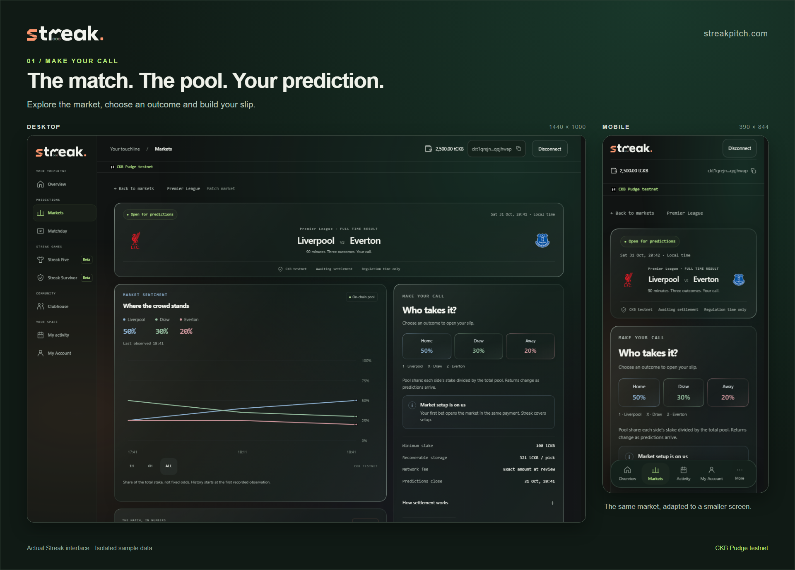
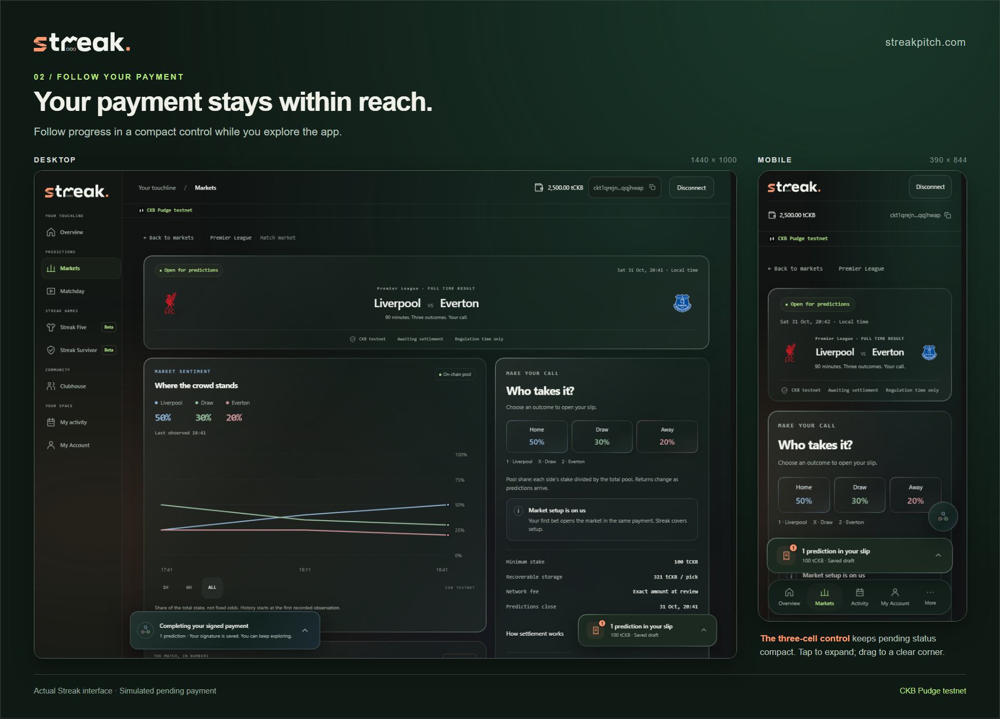
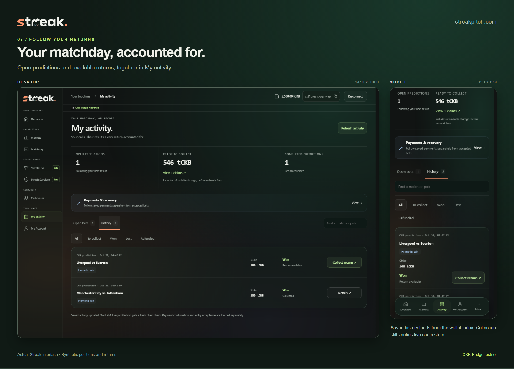
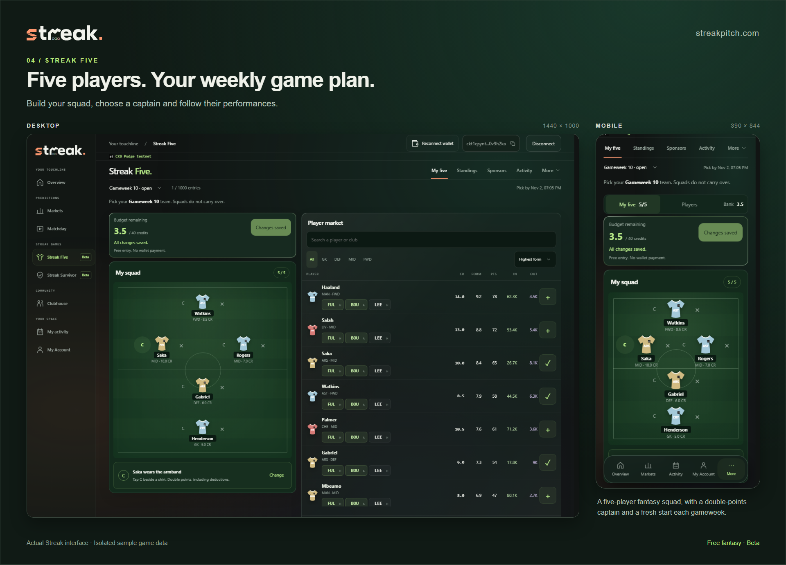
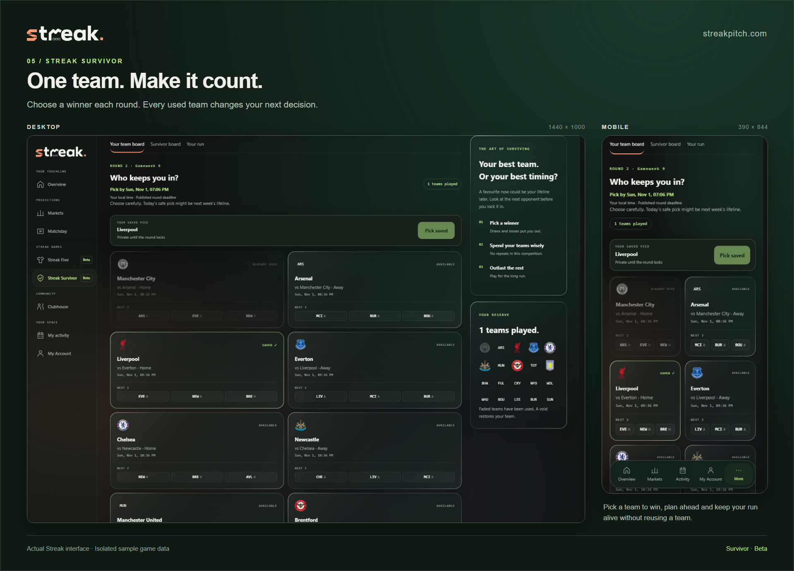

# Introducing Streak: your matchday predictions, settled on CKB

Home win, a stubborn draw, or the upset everyone else dismissed?

I'm building **[Streak](https://streakpitch.com)** to give your predictions a complete on-chain journey: choose an outcome, fund your position, follow the match and collect your return.

Streak is a football prediction platform on **CKB testnet**, with free weekly fantasy and Survivor games alongside its markets. Payments and rewards currently use **testnet tCKB**, not real-money prizes.

_Desktop and mobile views of the actual app, using synthetic local fixtures for this gallery._

## One slip for your matchday

Browse by day or league, open a fixture and choose Home, Draw or Away. Pool information shows how participating stakes are distributed; your potential return depends on the final pool and published rules.

Put up to **eight predictions into one slip and approve one wallet payment**. Each settles independently: one wrong call does not cancel another winning position.

Before signing, review your stakes, network fee and refundable CKB storage. A 100 tCKB prediction currently requires another **321 tCKB in refundable position storage**, plus its fee. The wallet total should never be a surprise.

Activity keeps accepted positions, pending transactions and collectable returns together, without requiring you to become a blockchain explorer expert.

## Keep browsing while your payment confirms

Recent wallet work covers restoring authorized connections, switching accounts, retaining drafts and recovering interrupted submissions.

On mobile, minimize a pending payment into an animated **three-cell tracker**. Move it to a corner and tap for details. Monitoring continues while you browse, avoiding the slip, navigation and dialogs.

_A synthetic pending payment demonstrates the tracker. This is an interface capture, not a live transaction receipt._

## What happens after the final whistle?

The configured football oracle reports results. CKB contracts enforce the resulting settlement and payout rules, creating separate claims that users can collect independently.

Winning positions receive their calculated return and recoverable storage. Losing positions still recover their storage deposit. Collection also has a network fee, shown before signing. Void, timeout and late-entry cases follow their respective refund rules.

Streak saves signed transaction bytes before submission and follows that original payment during recovery. A lost response should not become another request to pay.

_The same Activity screen at both sizes, populated with synthetic local history._

## Building around CKB, and learning from slow screens

First, provisioning every fixture in advance tied up capacity in markets nobody might use. Now **the first prediction creates an eligible market**, with Streak supplying its reserve capacity. New and existing markets can share one payment.

Second, Activity originally searched market by market for a wallet's positions. A central tracking cell looked tempting, but making every update consume and replace the same cell would create contention.

The solution combines **shared Rust scripts and separate market, deposit and claim cells** with an event-driven wallet index. Payment and settlement observations update the affected records, so opening Activity becomes a database read. Replay and targeted reconciliation handle missed updates and chain reorganisations.

The index makes discovery faster; it cannot grant a payout. Collection still validates actual on-chain spending conditions. The football oracle remains a trust assumption too: the blockchain enforces the rules, but does not independently know the score.

[Prediction architecture](https://github.com/HeySomtee/ckbuilder/blob/main/products/streak/docs/delivery/atomic-slip-correction.md) · [Activity design and measurements](https://github.com/HeySomtee/ckbuilder/blob/main/products/streak/docs/delivery/event-driven-activity.md)

## A reason to come back every gameweek

Predictions are the foundation. Two beta games offer additional ways to join in without placing a stake:

- **Streak Five:** pick five EPL players within 40 credits and choose a double-points captain. Real performances earn points, and each gameweek starts fresh. It uses FPL player data and official deadlines, with Streak's own scoring rules. [How Fantasy Premier League works](https://fantasy.premierleague.com/help/rules).
- **Survivor:** choose one winning team each round, but never reuse a team. Save a favourite for later or use it to stay alive now. [Full Survivor rules](https://github.com/HeySomtee/ckbuilder/blob/main/products/streak/docs/delivery/survivor-implementation.md).

_The actual Five interface at both sizes, using isolated sample gameweek data._

_The actual Survivor interface at both sizes, using an isolated sample competition._

Sponsored Five gameweeks offer a **fixed tCKB reward pool**. Under the default terms, the top 5% qualify and share it in proportion to their points. The published gameweek rules govern eligibility; unsponsored weeks remain playable without a promised prize.

Anyone can bid to sponsor an eligible week, subject to its minimum. Top-ups combine, the winning eligible bid funds the pool, and losing bids are refunded. Sponsors can add a logo, website and introduction, or contribute without branding. These rewards use a disclosed **custodial testnet wallet**, separate from prediction contracts.

## Come try one prediction

The latest local release passed **77 required checks**, covering databases, browsers, Rust contracts and signed local-chain scenarios. Its newest Five live-points view and Survivor creator prizes are committed but not yet deployed; hosted Survivor funding and payout acceptance remain ahead.

Open **[streakpitch.com](https://streakpitch.com)**, head to **Markets**, and explore an open fixture. Make a testnet prediction and follow it through Activity. Five offers a free alternative if you prefer to start with fantasy football.

I'd welcome football fans trying the experience, developers reviewing the contracts, and CKB projects interested in sponsoring a gameweek.

**Try one prediction and tell me where the experience becomes unclear.**

[Source code](https://github.com/HeySomtee/ckbuilder) · [Development report](https://github.com/HeySomtee/ckbuilder/blob/main/reports/week-22.md)
