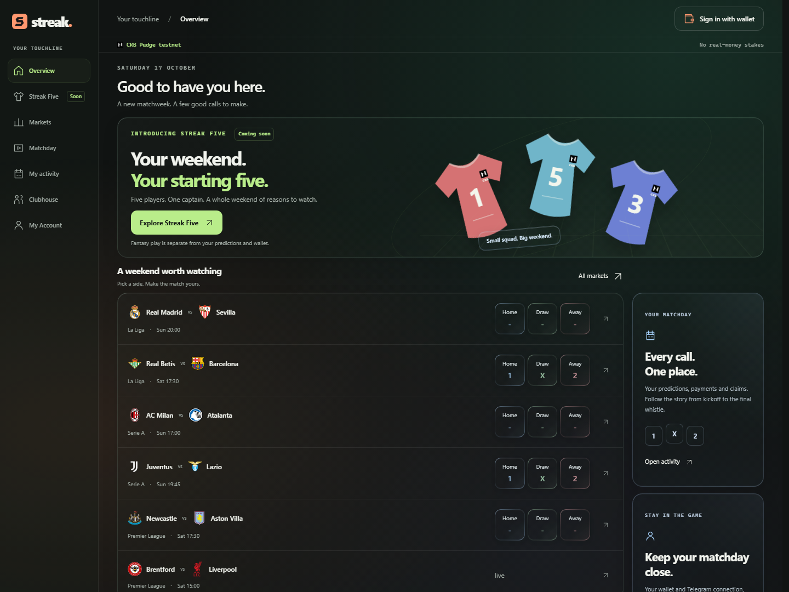
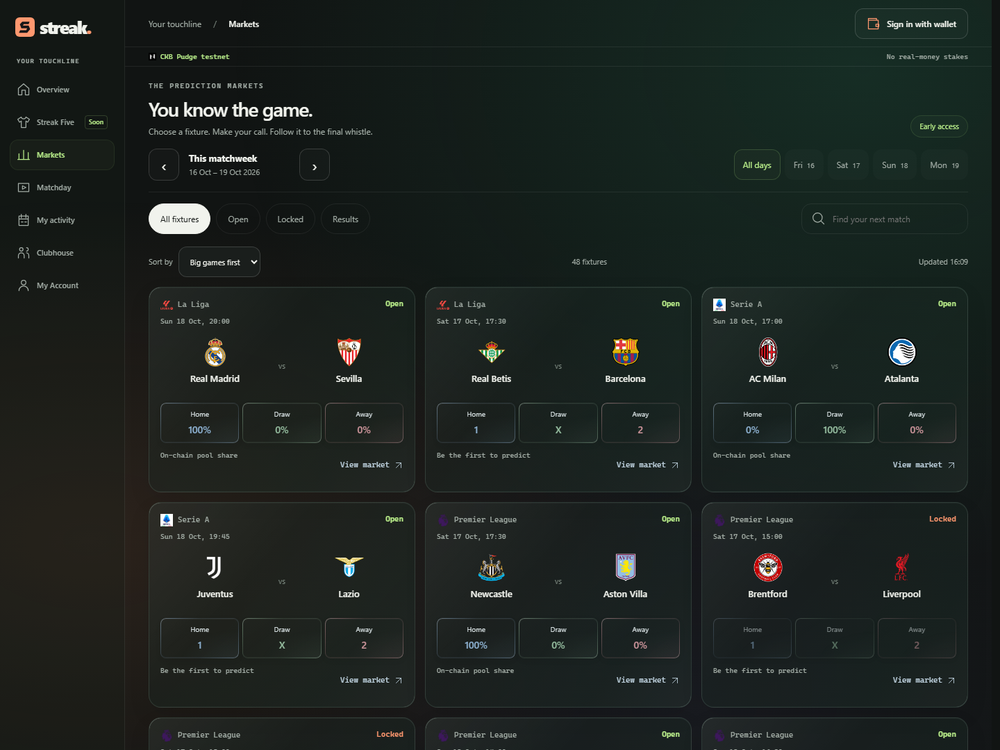
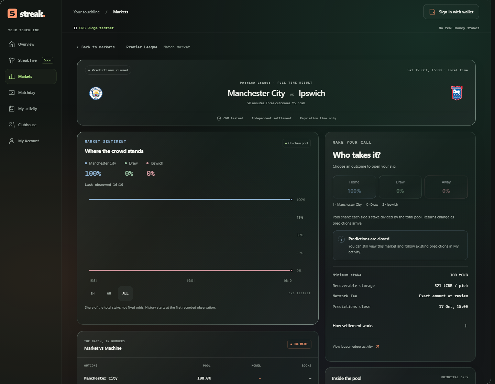
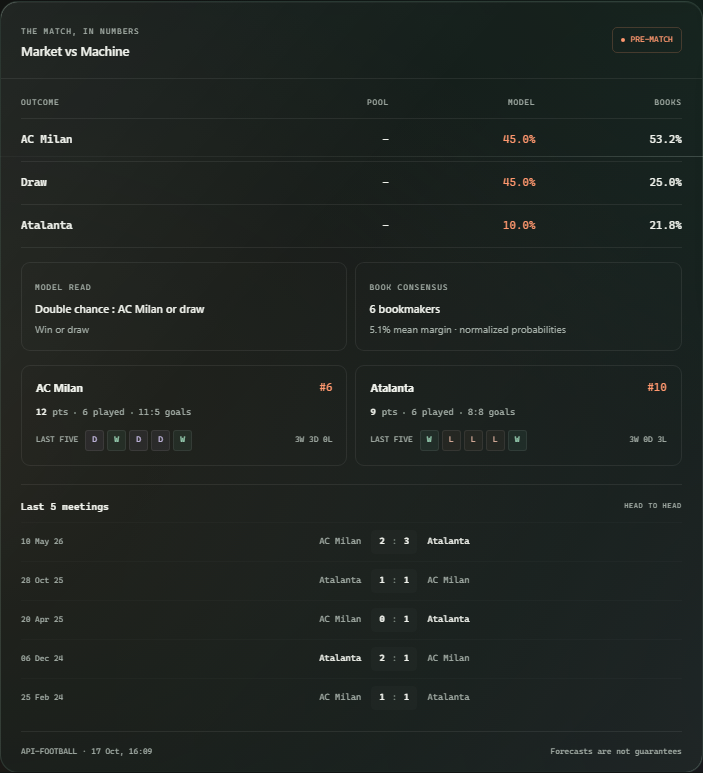
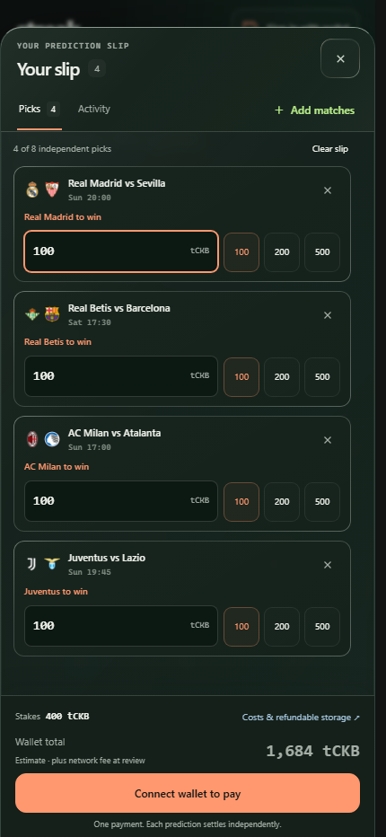
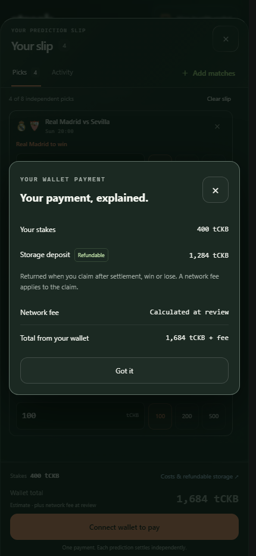

# Week 21: real fixtures, one payment, markets that open on demand

**17 October 2026.** Streak now connects the Rust testnet contracts to the football app. A user can choose several matches, approve one payment and have Streak fund the setup of any new markets in that transaction. A real three-prediction payment has committed on public testnet.

Week 20 proved settlement and independent claims in a separate contract demo. This week brings that work into the product, alongside a rebuilt interface and better match discovery. The integrated flow is running locally; the hosted operator setup remains a release prerequisite.



## New: markets open with their first prediction

Fixtures come from the football API, including club logos and Friday-to-Monday matchweeks. An eligible fixture does not need to tie up operator funds before anybody wants to play.

The first prediction starts this sequence:

1. The user adds up to eight independent predictions to a slip.
2. The sponsor checks fixture eligibility and reserves operator funding for markets that do not exist yet.
3. The browser checks the proposed transaction and shows the user's stake, refundable storage and network fee.
4. The user signs. The separate operator verifies and co-signs, saves the signed transaction for recovery, then broadcasts it.
5. One atomic transaction creates the required market cells and records every prediction. A slip can mix new and existing markets.

The Rust contract code is already deployed. First entry creates market state using that code, rather than deploying another contract binary. Later, the lifecycle worker obtains football results and submits reporting and settlement transactions. Each prediction settles independently, with owner-controlled claims.

Streak supplies **3,050 tCKB per new market**: one control cell and four pool shards, each with a 610 tCKB reserve. An existing market does not need that setup again. Sponsorship comes from this operator address:

```text
ckt1qzda0cr08m85hc8jlnfp3zer7xulejywt49kt2rr0vthywaa50xwsq2z5p82j67q2qn8p7c5vc9hafwhur4lj0ss26nlx
```

This is the operator's public testnet funding address. Users place predictions through wallet checkout, not by transferring to it manually.

### Public transaction evidence

[This confirmed payment](https://pudge.explorer.nervos.org/transaction/0xe6f60c254119cee71b105e58c24a7ef262e29aa1a5bc4e557d0be8ff985e33f8) opened Real Madrid vs Sevilla, Everton vs Chelsea and AC Milan vs Atalanta together:

| Contribution | Amount |
| --- | ---: |
| User's three stakes | 300 tCKB |
| User's refundable position storage | 963 tCKB |
| Network fee | 0.00006104 tCKB |
| Total user debit | **1,263.00006104 tCKB** |
| Operator's three market reserves | **9,150 tCKB** |

The large wallet debit exposed a real onboarding problem. Most of it was storage, not a betting fee. Checkout now separates these amounts before approval. Each position currently needs **321 tCKB storage**, recoverable through a claim after settlement whether it wins or loses. Claiming still incurs a network fee; storage does not return automatically at the final whistle.

Also public: [v4 contract deployment](https://pudge.explorer.nervos.org/transaction/0x930bba6cce8cd6b1dc254cc3469249d7ba32f09b44bc20ea784f45e172cd606f) and a subsequent [Manchester City vs Ipswich payment](https://pudge.explorer.nervos.org/transaction/0x6d95987e6bdf44c22af091e3b8ea75c6e1de6c3a2d0d4df1b5a24c7baba2f448). These prove entry, not a new completed football settlement. Public settlement evidence remains in [Week 20](week-20.md); current settlement and recovery regressions use an isolated local chain.

## New: match discovery with football context

The ranking engine gives Premier League fixtures a **1.20 multiplier**, La Liga **1.12**, Serie A **1.06**, and other competitions **1.00**. Club profile points, the strength of the pairing, rivalry bonuses and knockout importance determine the score before that league boost.

For example, Barcelona vs Real Madrid scores **252**, the Milan derby **218**, and Manchester United vs Tottenham **188**. Premier League gets priority without burying El Clasico beneath every English fixture. Filters apply before ranking, and ranking happens before pagination, so important matches do not disappear onto later pages.

These are editorial discovery weights, not predictions of who will win. The engine ranks **matches**, not individual players. Player scoring belongs to the upcoming Five feature. The [ranking specification](../products/streak/docs/product/fixture-ranking.md) explains the formula; the [source](../products/streak/src/fixture-ranking.ts) contains the complete club weights.



## Refactored: the experience around a prediction

The landing page and app now share a denser football-focused design: smaller typography, clear glass, subtle blue, green and red outcome reflections, and navigation that fits the viewport. My Account brings wallet controls and Telegram linking together. My Activity serves predictions and recovery.

Match pages restore the useful detail from the original terminal: team form, standings, the last five meetings, provider forecasts and bookmaker comparisons. An interactive chart shows observed on-chain pool shares. Cards and detail pages use actual staked principal, excluding operator reserves and storage. Those percentages describe the crowd's money, not fixed odds or guaranteed winning probabilities.



*This chart is flat because the observed pool is entirely Home. No trading history was invented. Chart history is currently bounded in memory and resets with the API.*



The slip now separates **Picks** and **Activity**. A compact total leaves more room for selections; cost details open only when needed. Preparation and wallet approval animate inside the action button. Once signed, an expandable background tracker lets users continue browsing while confirmation or recovery proceeds.

 

*These mobile captures are unsigned draft estimates, not payment confirmations. All screenshots show the actual local app with API data. [Capture provenance](assets/week-21/capture-provenance.json) records their source and dimensions.*

Repeat-payment preparation also avoids redundant work: an eight-pick review shares one fresh fixture catalogue read instead of eight, and outputs sharing a creation transaction reuse one lookup. Live-cell and canonical-chain checks remain. Sponsor contention and ambiguous responses now preserve recovery rather than encouraging another payment. This reduces unnecessary requests; network confirmation still takes time.

## Verification and release boundary

The latest completed implementation gate passed **all 51 checks** on 17 October at 14:48 UTC: TypeScript, lint, unit and disposable PostgreSQL tests, Chromium and WebKit journeys, Rust VM checks and signed local-chain payment, settlement, claim, refund and reorg recovery scenarios. [Validation summary](assets/week-21/implementation-validation.json). Commit and push hooks require the full gate again for the exact release candidate. Hosted Actions remain paused under the account billing lock.

Render's current configuration deploys the web/API process. Hosted payments additionally need a durable sponsor, shared registry and lifecycle worker. Publishing main alone does not establish that operational readiness. Telegram account linking works; direct v4 payment notifications remain unfinished. The oracle is still trusted for football results, and the current contract has four shards with eight positions each. This is a bounded testnet implementation, not an audited mainnet launch.

## Next: your starting five

**Streak Five** is the next product milestone: a free weekly football challenge where you pick five players within a budget and give one the captain's armband. Their real performances build your score, with a weekly table and season standings giving people a reason to return even when they do not want to place a prediction.

The proposed starting format is one goalkeeper, one defender, two midfielders and one forward, with double points for the captain. Before opening entries, I will validate the player feed, implement entry locking and scoring, and publish understandable rules for postponements and corrections. Five stays separate from betting funds. Its banner is present today; the playable competition and an original Streak logo are still to build.

The immediate aim follows the feedback from Neon: finish the hosted testnet journey, make first use understandable, and use actual user feedback to guide improvements. Five will add a free way to join the football conversation. Incentive funding and launch commitments will be decided separately.
