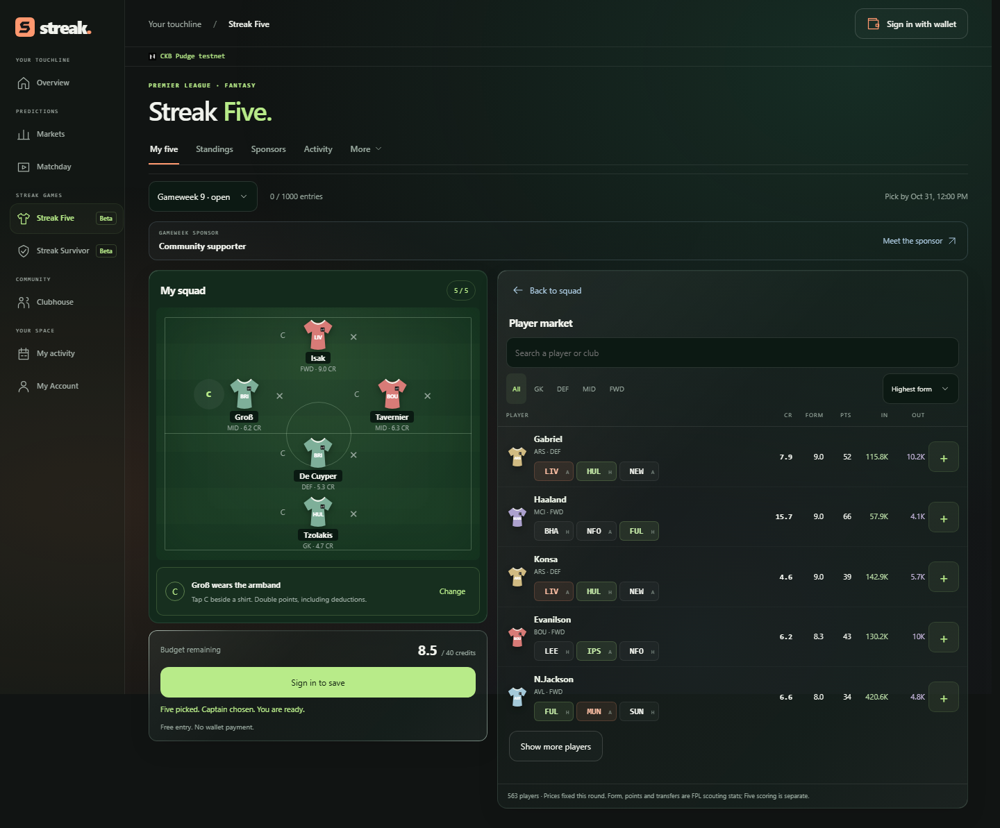
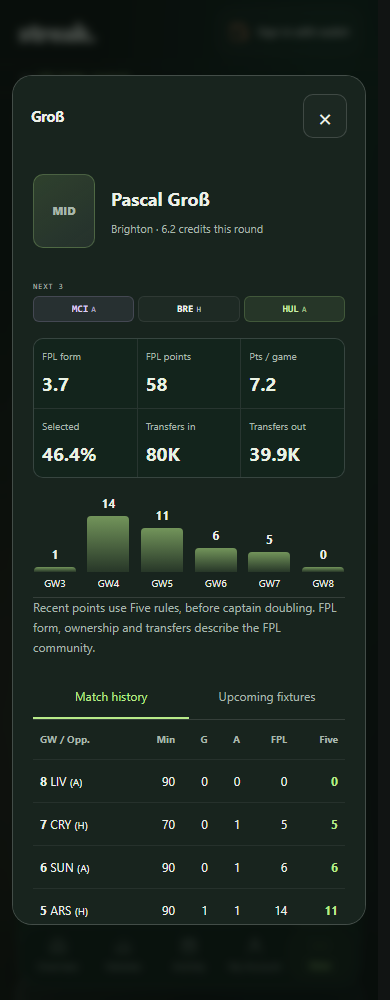
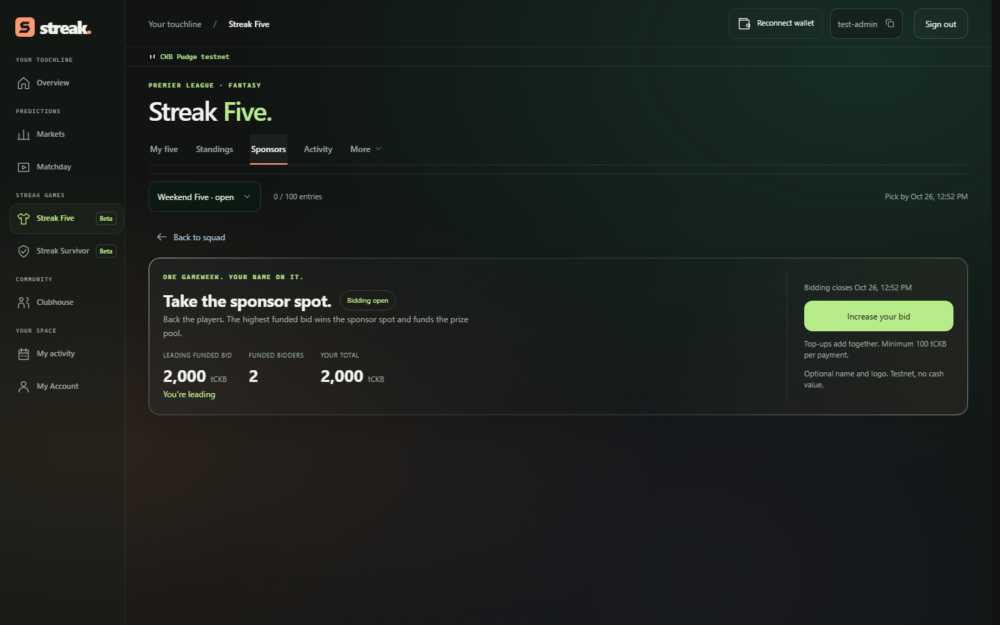
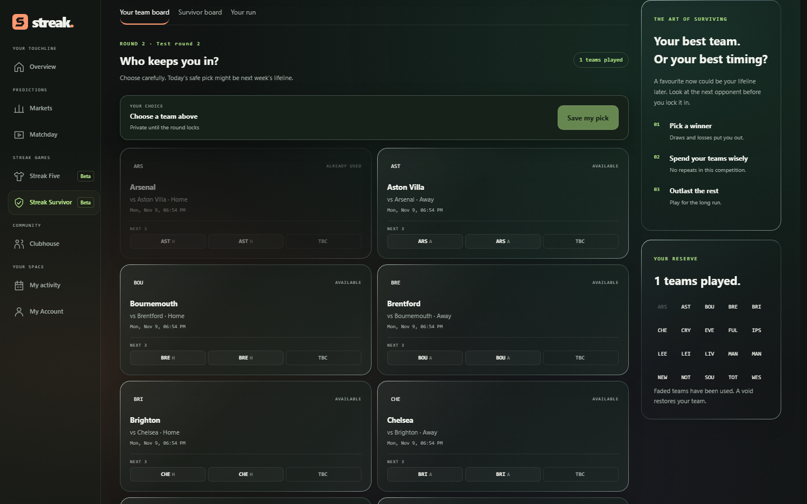

# Week 22: a reason to come back next weekend

**26 October 2026.** Streak now has its own home: **[streakpitch.com](https://streakpitch.com)**.

Week 21 connected football predictions to CKB and introduced markets that open with their first bettor. This week focused on the next question: what makes someone come back when they do not want to place a bet? Two playable beta games, Streak Five and Streak Survivor, now sit alongside the markets. I also spent time testing and reworking the parts that made the app feel slow or confusing.

## Streak Five: five players, one big decision

Five has moved from a banner into a playable weekly fantasy game: **one goalkeeper, one defender, two midfielders and one forward**, a 40-credit budget, and a captain who scores double. Entry is free. Each gameweek is a fresh start, so joining late does not mean chasing a season-long lead.

The EPL gameweek schedule, player prices and scouting information come through the FPL integration. Gameweeks progress automatically, with no weekly JSON import. Squads and sponsorship bids close at the same official FPL deadline. Prices and rules are fixed for the published round.

Player profiles show availability, form, transfers, recent performances and upcoming opponents. The next three fixtures are visible in the player list. FPL community statistics are labelled separately from Streak Five's own scoring; the profile compares both rather than implying they are identical.

The smaller squad is intentional. Every selection matters, the captain gives players a clear decision to own, and a weekly reset offers a manageable reason to return. This is the engagement hypothesis I want user feedback to test, not a claim of proven retention.

_These Five captures use the actual local app and API-sourced players. The squad is an unsigned, unsaved example, not a submitted entry or evidence of user adoption._

## Sponsors compete for the gameweek

The incentive design evolved from fixed rewards at point thresholds into a **fixed sponsored prize pool**. That bounds the amount distributed even if participation grows.

Anyone, including the admin, can bid to sponsor an eligible gameweek. Confirmed top-ups combine into one bid. The highest eligible total wins the sponsor spot and funds the pool; losing bids are returned through the dedicated rewards worker. Equal totals favour the bidder who reached that funded total first, under the published ordering rules.

The default qualifying group is the top 5%, with rewards proportional to qualifying players' final points. For example, with a 1,100 tCKB pool and two qualifiers scoring 100 and 120, their shares would be 500 and 600 tCKB. Published terms determine qualification and rounding. Unsponsored weeks remain playable, with no promised prize.

Sponsors can provide an optional name, logo, website and product description, or contribute without public branding. Approved winning branding gives the sponsor visibility around the game. This is sponsorship, not an investment product or a promised financial return.

_This auction screenshot uses synthetic browser-test accounts and amounts. It demonstrates the interface, not a live sponsor agreement._

There is also a real public-testnet milestone: a **[100 tCKB contribution to Gameweek 9](https://pudge.explorer.nervos.org/transaction/0x1fc68a65de602226d401af5ffddb878ea0d0ad1b35f19138c3fe51e7deaa9dd5)**. That round used the earlier community-contribution format and keeps those terms. It is evidence of sponsorship funding, not a completed live auction or winner payout. Five funds use a separate custodial testnet rewards wallet, with that custody disclosed.

## Survivor: when do you spend your strongest team?

Pick one team to win each round. A loss, draw or missed pick normally ends your run, and a team already used cannot be picked again. Saving a favourite for a harder round makes future fixtures part of today's decision. Published rules cover voids and the case where all actual picks lose.

Admins can create and publish free competitions, set the schedule and announce a prize. Players join, save a team and follow the remaining field. Picks stay private until the round locks. Used teams are visibly greyed out, with up to three scheduled fixtures shown for planning.

The latest usability correction gives drafts a dedicated **review → publish → join** path. Empty competitions can be deleted; competitions with entrants retain their records. Paid admission and automatic Survivor prize payouts are still unfinished. Announced Survivor prizes are not escrowed balances.

_The Survivor capture uses synthetic competition data in the actual application. No public competition or funded prize is being announced here._

## Less waiting, clearer decisions

The quality work went beyond new screens:

- Wallet restoration can reuse the previously authorized account after refresh without prompting or signing automatically.
- Activity shows verified positions progressively instead of waiting for every market. One unavailable market no longer blocks unrelated results.
- Claim reviews, saved signatures and background recovery better handle delayed wallet approval and interrupted requests.
- Five now opens on the squad, with secondary content in tabs, explicit captain guidance, Save changes states and mobile Back to squad controls.
- Markets gained day-by-day calendar navigation, a mobile date strip and league filtering, including Champions League fixtures.

The on-demand market funding from Week 21 remains the prediction foundation: Streak's operator supplies new-market reserves, so unused fixtures do not tie up setup capital in advance.

## Test the whole week without waiting a week

I added a local test-data mode for the **same Five and Survivor components, services and wallet paths**, rather than a separate demonstration page. Admin controls can advance test deadlines, apply dummy results and move to the next round immediately. Test records and the test rewards wallet are isolated; an environment setting restores ordinary API data. These controls are not public hosted features.

The latest implementation gate passed **all 71 checks**: TypeScript and lint, domain and database tests, Chromium/WebKit journeys, Rust contracts and signed local-chain payment, refund and reward scenarios. The six-step Five rehearsal exercised competing bids, a top-up, closure/refund, scoring and prize collection. Local-chain success is separate from physical MetaMask and hosted acceptance. [Validation summary](assets/week-22/validation.json).

## What comes next

The priority is to finish hosted end-to-end acceptance and gather feedback from people trying the core flows, following Neon's advice to make the testnet interactive and fun. Five offers a free weekly entry point; Survivor adds longer-term football strategy; sponsorship gives supporters a visible role in funding rewards.

Both games remain beta. Mainnet, automatic Survivor prize payments, double-gameweek player support, and an original logo/favicon are not completed milestones. There is no claim of an established user base or grant readiness yet. The next useful evidence is whether people can enter, return, collect and tell us what needs improving.

[Screenshot provenance](assets/week-22/capture-provenance.json) distinguishes API-data captures from synthetic test states.
