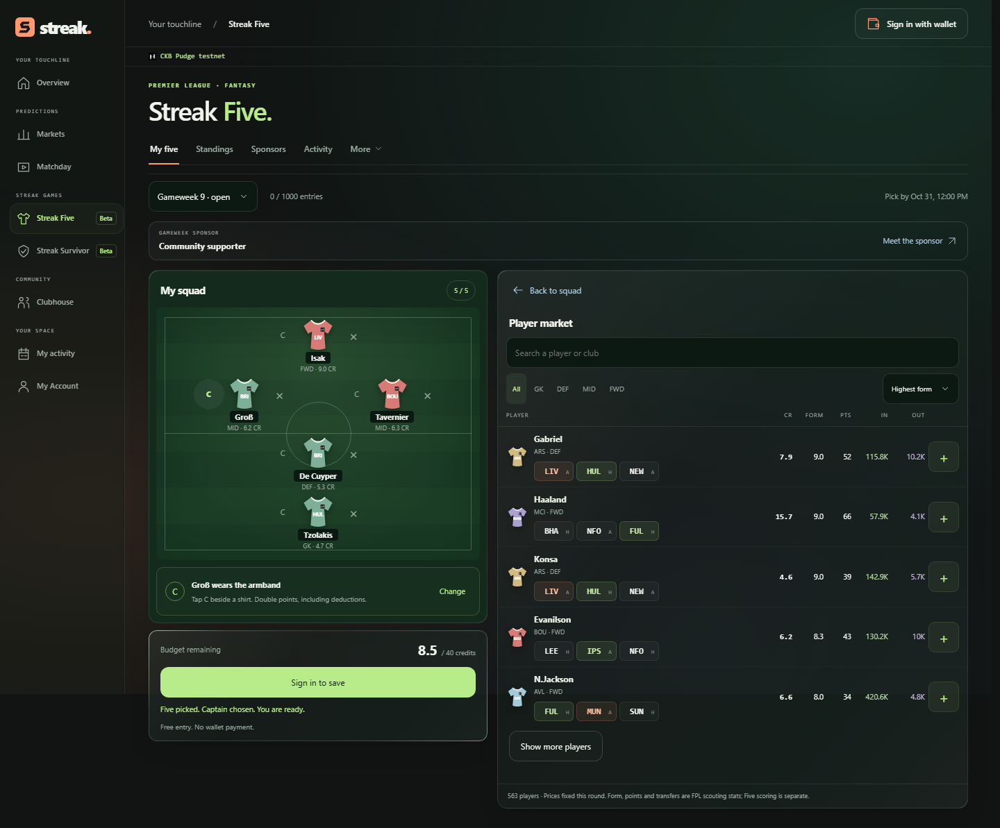
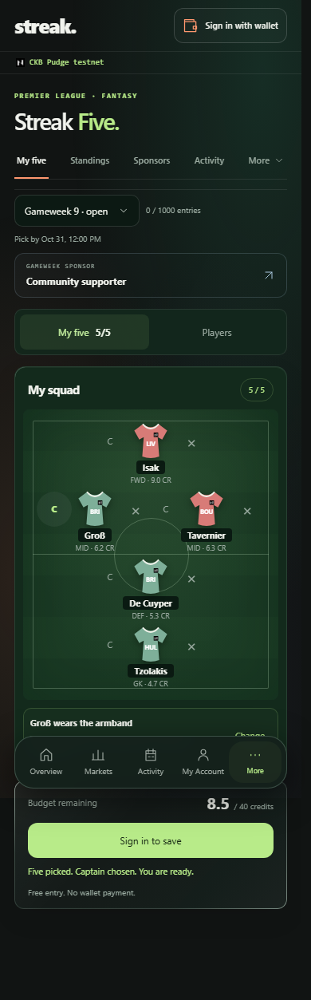
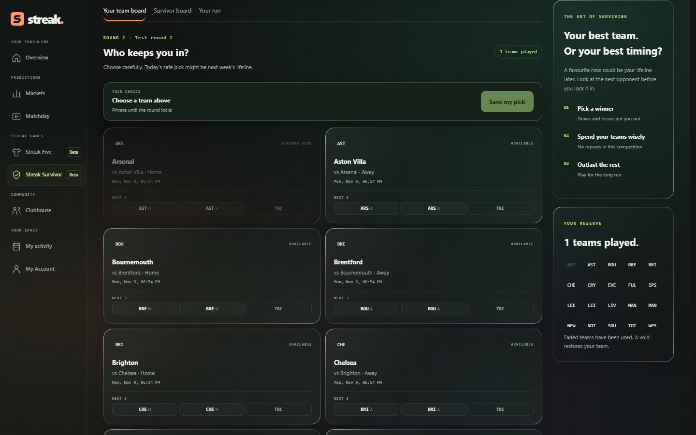

# Week 23: faster reads, recoverable payments, a better matchday

**1 November 2026 | Work since the Week 22 report of 26 October.**

Last week introduced Five and Survivor alongside Streak's prediction markets. This week, feedback exposed the next priority: connecting a wallet, paying and finding a return should feel like one coherent journey. An address could appear while sign-in failed, Activity spent too long checking markets, and payment panels crowded the mobile screen. I worked through those problems before adding more games.

Streak remains at **[streakpitch.com](https://streakpitch.com)**, using CKB testnet and testnet tCKB. The biggest architectural change is how it reads prediction history, without changing who controls the funds.

## Activity no longer searches every market when you open it

Previously, opening Activity could trigger market-by-market chain discovery. The more history there was, the more work the page had to wait for.

I moved the normal read path to **wallet-indexed records in PostgreSQL**. Payment and market-lifecycle events update those records. When a market changes, one canonical reconstruction updates its participants together. The page reads the saved result, and sign-in starts prefetching before the user opens Activity. Reading history no longer needs an active wallet signer.

Why not put everyone's positions in one central contract? On CKB, updating shared mutable state means spending and replacing its cell. A single tracking cell would make unrelated users compete to update it. Streak keeps independent market, deposit and claim cells, with shared scripts enforcing their rules. The database makes discovery fast; **it cannot authorize a withdrawal**.

That distinction matters throughout settlement. A submitted payment is not yet an accepted bet. A reported result is not yet a funded claim. Collection still checks live cells, ownership, amounts and fees. Refund and payout recovery keep their signed transaction records, so a refreshed screen cannot silently turn an uncertain payment into another payment.

Events are the normal update path, with durable replay and targeted reconciliation for missed notifications, pending transactions and chain reorganizations. This is not a claim that every background check has disappeared. A local benchmark read 24 synthetic markets in **17.6–33.6 ms with zero chain reads**; that is a database-path measurement, not a hosted speed guarantee.

Failed reads now show one useful retry state rather than three “Unavailable” totals. Previously loaded records remain visible and labelled. I also corrected a local launcher gap that had blocked the new Activity routes. [Architecture and verification](../products/streak/docs/delivery/event-driven-activity.md).

## Wallet feedback became concrete recovery work

The wallet work separates three states that the old UI blurred: an address being displayed, a provider being ready to sign, and an authenticated Streak session.

- Explicit EVM sign-in renews account access, handles delayed provider discovery and checks that the authenticated account matches the signing account. Errors now appear where the action happened, including inside the slip.
- **Disconnect** replaces Sign out. It clears app identity and private caches, requests provider disconnection where supported, and prevents a cancelled reconnect from restoring the previous account. Signed recovery records stay attached to their original owner.
- Native-wallet compatibility gained stricter JoyID passkey proof handling and restoration adapters. Login support is not blanket payment support; sponsored prediction payments still require supported native CKB or EVM locks.

The owner confirmed Zerion Android sign-in worked after updating Zerion. That is useful physical-device feedback, but the app update was part of the resolution and this does not establish compatibility with every wallet. [Wallet changes and limits](../products/streak/docs/delivery/wallet-compatibility.md).

On mobile, the wallet header now uses two compact rows, with balances rounded down to two decimal places. Finished or unsent payment notices can close. Pending payments keep monitoring but minimize into a **draggable, animated three-cell button**. Tap to expand; corner placement avoids the slip, navigation and dialogs.

## A recognizable identity, including while waiting

The approved On form wordmark is now integrated across the app, with its cut S, chart-shaped r, three linked cells and standalone favicon. A two-strike startup reveal runs when entering the Season app, while the shell and data load underneath. It is skippable and does not replay on page navigation or appear on the landing page.

Those linked cells also replace generic loading indicators across React and retained legacy screens: rotating, gently pulsing cells for compact controls, and a connecting wave for wider progress states. Reduced-motion and background-tab behavior are included. Animation follows real work; it does not delay a payment or pretend it has confirmed. [Identity](../products/streak/docs/delivery/startup-identity.md) · [Loading implementation](../products/streak/docs/delivery/connected-loading.md).

## Five: put the squad first, then let players follow it

Streak Five is the free weekly five-player fantasy game introduced in Week 22, using EPL player and gameweek data from [Fantasy Premier League](https://fantasy.premierleague.com/). This week's changes focused on actually playing it:

- The game starts much higher on screen. At the measured 1276 × 662 desktop viewport, **75.2% of the initial viewport lies below the game start**. Budget and save controls are above the pitch; the remaining budget stays visible in the mobile player panel.
- The sponsor payment validator now accepts legitimate MetaMask transactions whose inputs share one signing witness, while retaining chain validation and exact payment checks.
- Unfinished bid amounts can be changed. New cumulative bids must exceed the highest submitted or confirmed total; top-ups still combine. Accepted signed contributions remain immutable and recoverable.
- The current locked squad now remains visible with updating player points, captain scoring and provisional-score labels. **Pick next team** opens a separate upcoming-week editor. Squads do not carry over automatically.

The live-team change is now published. [Current team and next-week picks](../products/streak/docs/delivery/five-live-team.md).

## Survivor: visible deadlines and funded prizes

Survivor asks players to pick one winning team each round without reusing a team. New competition schedules now follow the **official FPL deadline, normally 90 minutes before the first EPL fixture**, and show the closing time. Admins can enter a round count across the available remaining gameweeks instead of choosing from an unnecessarily short list.

A positive creator prize now requires confirmed funding before publication. Following the approved approach, it uses the **existing custodial testnet rewards wallet**, not a new escrow contract. The implementation includes funding recovery, eligible cancellation refunds and winner payouts through the shared rewards journal. Old announced prizes are not retroactively treated as funded.

This work is now published. New v2 competitions also finish early when one definite survivor remains. Pending results cannot decide a winner; if every actual picker loses, pickers are rescued with those teams still spent, while missed picks remain out. The final scheduled round can produce joint winners. Existing competitions retain their published timing. [Outcome rules](../products/streak/docs/delivery/survivor-outcomes.md). Hosted creator funding, refunds and final winner payouts still need acceptance. [Funding rules and verification](../products/streak/docs/delivery/survivor-creator-prizes.md).

## Small controls, fewer mobile dead ends

All ten dropdowns now use compact in-page glass menus instead of native pickers that failed inside Zerion. The shared controls cover touch selection, keyboard navigation and dialog focus. Pending buttons retain high-contrast linked-cell loaders while remaining disabled. Physical Zerion acceptance of the new dropdowns remains separate from the automated Chromium/WebKit checks.

## Verification, community and the remaining work

The latest complete local gate passed **all 79 checks** on 1 November: builds and lint, application regressions, disposable PostgreSQL, Chromium/WebKit journeys, Rust contracts and signed local-chain prediction and Five reward scenarios. It finished at 06:44:51 UTC on Node 24.14.0 for exact tree `95be163ef780`. The release commit records this evidence. [Verified runtime release](https://github.com/HeySomtee/ckbuilder/commit/30599d2732c0096446480ceb853e5876f60984d2).

For the hosted campaign, six wallets were funded and the owner marked the squad-saving, reload and account-switch checks complete. The end-to-end auction, refunds, match settlement, Survivor progression and final rewards are not yet a completed acceptance campaign.

I also prepared separate GitHub and Nervos Talk posts, five paired desktop/mobile boards, a copy-ready page and upload-ready images. The owner reports the GitHub issue update is posted. Nervos Talk publication remains blocked by the account's link/media permissions; the full draft and a text-only alternative are preserved.

**Release position, checked 1 November:** runtime `30599d2` and release notes `dff2340` are pushed to GitHub main. The public frontend matched the verified build at 06:52:27 UTC. Hosted CI remains paused; a deployed frontend does not prove successful live settlement.

Next is to finish the hosted journeys through actual results, refunds and collection. Both games remain beta. Mainnet, BTC/USDC payments and fiat onboarding are not delivered features. The useful milestone is a complete matchday users can follow and recover, not another screen added to the menu.

## Game screenshots

These previously published captures show the actual game interfaces at the Week 22 milestone, before this week's live-points and outcome updates. They illustrate the games, not evidence of current payment or settlement acceptance.

